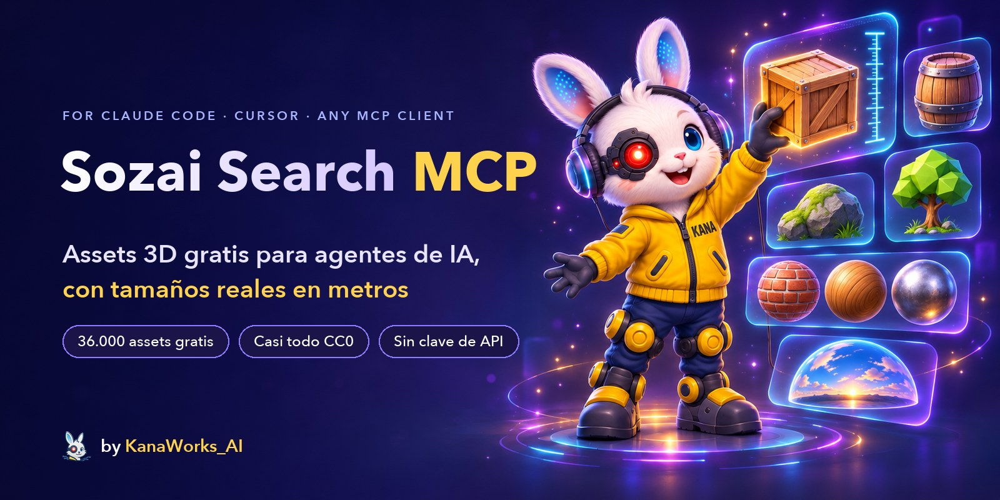

<div align="center">



<p>
  <a href="LICENSE"></a>
  <a href="https://modelcontextprotocol.io"></a>
  
  
  
  <a href="https://github.com/kanaworksai-hue/sozai-search-mcp/actions/workflows/test.yml"></a>
  <a href="https://github.com/kanaworksai-hue/sozai-search-mcp/stargazers"></a>
</p>

<p><a href="https://github.com/kanaworksai-hue"></a>&nbsp;<a href="https://github.com/kanaworksai-hue"><b>Un proyecto de KanaWorks_AI</b></a></p>

[English](README.md) | [日本語](README.ja.md) | [简体中文](README.zh-CN.md) | [한국어](README.ko.md) | [Português](README.pt-BR.md) | **Español**

[Primeros pasos](#-primeros-pasos) · [Herramientas](#-herramientas) · [Fuentes](#-fuentes-y-licencias) · [Búsqueda semántica](#-búsqueda-semántica-opcional) · [Preguntas frecuentes](#-preguntas-frecuentes) · [⭐ Dale una estrella](#-apóyalo-con-una-estrella)

</div>

**Sozai Search MCP** da a Claude Code, Claude Desktop, Cursor y cualquier otro cliente [MCP](https://modelcontextprotocol.io) una biblioteca de **39.000 assets 3D gratuitos**: modelos fotorrealistas, materiales PBR y HDRIs de Poly Haven y ambientCG, modelos low-poly para juegos de Kenney, Quaternius, KayKit y Polygonal Mind, avatares VRM con rig de Open Source Avatars, naves, rovers y telescopios de la NASA, y fichas de Quixel Megascans. Pide "una caja de madera de menos de 1 m de alto" o "una roca con musgo"; el agente busca por palabras o por significado, mira las vistas previas y deja los archivos en tu proyecto, a su tamaño real en metros. (*Sozai*, 素材, significa "materiales" en japonés.)

Sozai Search es un índice. No aloja ningún archivo de assets: cada resultado apunta a la fuente oficial, y es tu propio equipo el que descarga los archivos desde allí.

## ✨ Características

<table>
<tr>
<td align="center" width="25%"><br><b>Búsqueda</b><br><sub>Palabras clave y sinónimos, o significado en cualquier idioma ("苔むした岩" encuentra rocas con musgo)</sub></td>
<td align="center" width="25%"><br><b>Tamaños reales</b><br><sub>Todos los tamaños en metros; filtra por dimensión mayor, altura y número de polígonos</sub></td>
<td align="center" width="25%"><br><b>Listo para usar</b><br><sub>Un <code>.glb</code> por modelo, carpetas PBR, HDRIs y además <code>CREDITS.md</code></sub></td>
<td align="center" width="25%"><br><b>Gratis</b><br><sub>Casi todo CC0; <code>redistributable_only</code> deja solo lo que puedes distribuir</sub></td>
</tr>
</table>

- **Mira antes de elegir:** `view_assets` le muestra al agente hasta 8 vistas previas, así que elige por lo que ve, no por el título.
- **Llega al tamaño correcto:** los modelos de los kits están calibrados en metros (una puerta mide 2,1 m, una persona 1,75 m) y se entregan ya escalados; los rigs y las animaciones siguen funcionando.
- **Ligero:** el servidor es Python que usa solo la biblioteca estándar, sin dependencias en tiempo de ejecución. Arranca en unos 25 ms, ocupa unos 23 MB en reposo y no guarda estado entre llamadas.
- **Seguro con datos no confiables:** solo https y solo a los servidores de las propias bibliotecas; todas las rutas se quedan dentro de la carpeta que indicaste; nunca borra tus archivos.

## 🧭 Cómo funciona

```
"a wooden crate under 1 m tall"
   └─ search_assets   keywords + meaning, filtered by kind, size, height, polycount, licence
   └─ view_assets     the agent looks at the candidates' previews
   └─ fetch_asset     downloads from Poly Haven / ambientCG (or your local kit zip),
                      packs one .glb at real scale, appends the credit to CREDITS.md
```

`sozai build` descarga los datos publicados una sola vez: un zip con los registros de todas las bibliotecas (qué es cada asset, su tamaño, su licencia y dónde conseguirlo) y los vectores de búsqueda. Sin archivos de assets ni vistas previas.

## 🚀 Primeros pasos

### 🤖 Instálalo con tu agente de IA

Pásale la URL de este repositorio a Claude Code, Codex u otro agente y pídele que instale Sozai Search MCP. Estos son los pasos que debe seguir (también sirven a mano):

1. **uv:** comprueba `uv --version`; si no tienes uv, instálalo:
   - macOS / Linux: `curl -LsSf https://astral.sh/uv/install.sh | sh`
   - Windows: `powershell -ExecutionPolicy ByPass -c "irm https://astral.sh/uv/install.ps1 | iex"`
2. **Registra el servidor:** ejecútalo en la carpeta del propio proyecto del usuario. No hace falta clonar: uv descarga Sozai Search desde GitHub.

   ```bash
   # Claude Code: solo en este proyecto (escribe .mcp.json)
   claude mcp add sozai -s project -- uvx --from git+https://github.com/kanaworksai-hue/sozai-search-mcp sozai

   # Codex: todos los proyectos (escribe ~/.codex/config.toml)
   codex mcp add sozai -- uvx --from git+https://github.com/kanaworksai-hue/sozai-search-mcp sozai
   ```

   Otros clientes (Claude Desktop, Cursor, ...) usan el mismo comando en su configuración JSON:

   ```json
   {"mcpServers": {"sozai": {"command": "uvx", "args": ["--from", "git+https://github.com/kanaworksai-hue/sozai-search-mcp", "sozai"]}}}
   ```

3. **Abre una sesión nueva:** Los servidores MCP se cargan al empezar la sesión. La primera vez, Claude Code pide aprobar el `.mcp.json` del proyecto. Compruébalo con `claude mcp list` o `codex mcp list`.
4. **Pruébalo:** busca "wooden crate". La primera búsqueda descarga los datos publicados (unos 13 MB) y crea el índice en unos segundos. Pasa a `fetch_asset` una carpeta del proyecto con ruta absoluta.
5. **Búsqueda por significado (opcional):** para consultas descriptivas en cualquier idioma, descarga una vez el modelo de consultas (unos 350 MB):

   ```bash
   uvx --from "sozai-search-mcp[semantic] @ git+https://github.com/kanaworksai-hue/sozai-search-mcp" sozai semantic-setup
   ```

   Después regístralo con `--from "sozai-search-mcp[semantic] @ git+https://github.com/kanaworksai-hue/sozai-search-mcp"` en lugar de `--from git+https://github.com/kanaworksai-hue/sozai-search-mcp`.

### 🛠️ Desde un clon

Necesitas [uv](https://docs.astral.sh/uv/) (incluye Python 3.10 o posterior).

```bash
git clone https://github.com/kanaworksai-hue/sozai-search-mcp
cd sozai-search-mcp
uv sync
uv run sozai build            # downloads the published data (one zip, no asset files) and indexes it
uv run sozai search "wooden crate" --kind model
uv run sozai fetch polyhaven:wooden_crate_01 ./assets --quality web
```

**Claude Code** (registrado solo para un proyecto):

```bash
claude mcp add sozai -s project -- uv run --directory /path/to/sozai-search-mcp sozai
```

**Cualquier otro cliente MCP** (Claude Desktop, Cursor, ...):

```json
{
  "mcpServers": {
    "sozai": {
      "command": "uv",
      "args": ["run", "--directory", "/path/to/sozai-search-mcp", "sozai"]
    }
  }
}
```

Sin clonar el repositorio, uv puede ejecutarlo directamente desde GitHub: `uvx --from git+https://github.com/kanaworksai-hue/sozai-search-mcp sozai`. Si todavía no has ejecutado `sozai build`, la primera búsqueda crea el índice. Pásale a `fetch_asset` una ruta de carpeta absoluta: un servidor MCP no se ejecuta en la carpeta de tu proyecto.

## 🧰 Herramientas

| Herramienta | Qué hace |
|---|---|
| `search_assets` | Palabras clave en inglés más sinónimos, con filtros por tipo, estilo, fuente, tamaño y altura en metros, número de polígonos, tileable, con rig, animado y `redistributable_only` (archivos CC0 que puedes distribuir en un proyecto abierto). Resultados breves. |
| `get_asset` | El registro completo: tamaños, mapas, etiquetas, licencia, créditos y cómo descargarlo. |
| `view_assets` | Muestra las vistas previas de hasta 8 candidatos. Las vistas previas de Megascans se leen de la página del asset en Fab cuando se piden, como la vista previa de un enlace, y se guardan en caché. |
| `fetch_asset` | Coloca los archivos en una carpeta: un modelo como un único `.glb`, un material como una carpeta de mapas PBR (Poly Haven añade `material.json` con el tamaño real del tile; ambientCG, materiales listos en `.tres` / `.mtlx` / `.blend`) y un HDRI como `.hdr` / `.exr`. Añade los créditos a `CREDITS.md`. Solo añade o reemplaza los archivos del propio asset. |
| `update_index` | Reconstruye el índice local y descarga datos publicados más recientes cuando esta versión de Sozai Search los necesita. |

Los tamaños son `[width, height, depth]` en metros, donde la altura es el eje vertical. Los materiales dan `[width, height]` del área que cubre un tile de la textura.

## 📚 Fuentes y licencias

| Biblioteca | Qué ofrece | Licencia | Archivos |
|---|---|---|---|
| [Poly Haven](https://polyhaven.com) | Modelos, materiales y HDRIs fotorrealistas | CC0 | Se descargan de Poly Haven. **Powered by Poly Haven.** |
| [ambientCG](https://ambientcg.com) | Materiales, HDRIs, calcomanías y modelos | CC0 | Se descargan de ambientCG |
| [Kenney](https://kenney.nl) | Kits low-poly para juegos | CC0 | Desde los zips de los kits que descargas ([ver más abajo](#-bibliotecas-de-kits-kenney-quaternius)) |
| [Quaternius](https://quaternius.com) | Modelos low-poly, muchos con rig y animados | CC0 | Desde los zips de los kits que descargas |
| [KayKit](https://kaylousberg.com) | Packs low-poly para juegos: personajes, mazmorra, muebles, restaurante, Halloween | CC0 | Se descargan de GitHub |
| [Polygonal Mind](https://github.com/PolygonalMind/initiative-opensource-release) | Objetos y escenarios low-poly de mundos del metaverso (versiones GLB de [ToxSam](https://github.com/ToxSam/cc0-models-Polygonal-Mind)) | CC0 | Se descargan de GitHub |
| [Open Source Avatars](https://www.opensourceavatars.com) | Avatares humanoides VRM con rig: 100Avatars de Polygonal Mind (también en versión vóxel) y más ([registro](https://github.com/ToxSam/open-source-avatars)) | CC0 | Se descargan de Arweave |
| [NASA 3D Resources](https://science.nasa.gov/3d-resources/) | Naves espaciales, rovers, telescopios, cohetes, asteroides y equipo de astronauta ([repositorio](https://github.com/nasa/NASA-3D-Resources)); sin tamaño en metros, porque los archivos no comparten unidad | [Pautas de medios de la NASA](https://www.nasa.gov/nasa-brand-center/images-and-media/) | Se descargan de GitHub |
| [Quixel Megascans](https://www.fab.com/sellers/Quixel) | Escaneos fotorrealistas | Fab Standard License | Sozai Search no puede descargarlos: los resultados enlazan a Fab |

Los Megascans son gratis en Fab: reclámalos con una cuenta de Epic y luego descárgalos. Puedes usarlos en tus proyectos, pero no redistribuir los archivos. Las tres dimensiones de una ficha no siguen un orden de ejes fijo, así que se indican como `dims_m` (de mayor a menor) y quedan fuera de los filtros de altura.

Si no se puede acceder a la release de datos, `sozai build` lee directamente las APIs de las bibliotecas: Poly Haven y ambientCG (unos 5.300 assets), sin los registros de los kits, sin Megascans y sin búsqueda semántica. `sozai build --live` hace lo mismo a propósito, para los assets más recientes que la release. Después de actualizar Sozai Search, la primera búsqueda pasa a la release de datos que espera la nueva versión.

## 🔎 Búsqueda semántica (opcional)

```bash
uv sync --extra semantic
uv run sozai semantic-setup   # downloads the query model once (about 350 MB)
uv run sozai build            # if not done yet: the asset vectors come with the published data
```

Registra el servidor con el extra para que pueda cargar el modelo: `uv run --directory /path/to/sozai-search-mcp --extra semantic sozai` (en una configuración JSON, añade `"--extra", "semantic"` antes de `"sozai"`).

A partir de ahí, la búsqueda también encuentra resultados por significado, en cualquier idioma: "algo para sentarse en una taberna medieval" encuentra taburetes y bancos. Cada asset tiene un vector de sus palabras y, si tiene vista previa, otro de su imagen ([EmbeddingGemma 2](https://huggingface.co/google/embeddinggemma-2), un único espacio para texto e imágenes), así que los modelos de kits con nombres escuetos se encuentran por su aspecto. La clasificación final combina los rankings por palabras clave, por texto y por imagen.

En el momento de buscar solo se procesa la consulta: el modelo de texto en ONNX int8 en la CPU, unos 45 ms, fijado a una revisión concreta y verificado con SHA-256. Se ejecuta en un proceso aparte que arranca con la primera búsqueda y se cierra tras cinco minutos de inactividad, así que un servidor en reposo mantiene su bajo consumo.

## 🧩 Bibliotecas de kits (Kenney, Quaternius)

Estas bibliotecas no tienen API. Sus modelos aparecen en los datos publicados, pero `fetch_asset` solo puede entregarlos después de que descargues los kits y los importes:

```bash
uv run sozai ingest kenney ~/Downloads/kenney-kits
uv run sozai ingest quaternius ~/Downloads/quaternius-packs
```

Deja los zips de Kenney con el nombre con el que se descargan (`kenney_city-kit-commercial_2.1.zip`). Nombra los zips de Quaternius como `quaternius_<pack>.zip`, donde `<pack>` es el nombre que aparece en la dirección de la página del pack (`quaternius.com/packs/<pack>.html`); sufijos como `_fbx` o `_part2` no son problema. Así, los modelos importados sustituyen a sus registros publicados en lugar de aparecer dos veces.

Cada modelo se mide (tamaño, triángulos, rig, animaciones) y recibe la imagen de vista previa del kit. Los modelos que solo vienen en FBX se convierten a GLB con Blender si está instalado (se conservan los rigs y los clips de animación), y los modelos sin vista previa reciben una renderizada con Blender sin interfaz. Los kits con un objeto de referencia fiable se calibran en metros; los que no lo tienen conservan las unidades de sus archivos en `attributes.size_units` y no indican tamaño, para que los filtros de tamaño nunca las confundan con metros. Un kit cuyo archivo de licencia no es CC0 se registra con una referencia a ese archivo y queda fuera de `redistributable_only`.

## ⚙️ Configuración

Variables de entorno, todas opcionales:

| Variable | Efecto |
|---|---|
| `SOZAI_HOME` | Dónde se guardan el índice, los datos, el modelo y las cachés (por defecto: `~/Library/Application Support/sozai`, `%LOCALAPPDATA%\sozai` o `~/.local/share/sozai`). |
| `SOZAI_SEMANTIC=0` | Solo búsqueda por palabras clave, aunque el extra semántico esté instalado. |
| `SOZAI_FAB_PREVIEWS=0` | No leer nunca las páginas de Fab para obtener vistas previas de Megascans. |
| `SOZAI_BLENDER` / `BLENDER_PATH` | El ejecutable de Blender que usa `sozai ingest`, si no lo encuentra por sí solo. |

Sozai Search solo se conecta por https a las bibliotecas anteriores, a GitHub (la release de datos) y a Hugging Face (el modelo de consulta).

## ❓ Preguntas frecuentes

<details>
<summary><b>¿Puedo usar los assets en un juego o un vídeo comercial?</b></summary>

Los assets de Poly Haven, ambientCG, Kenney, Quaternius, KayKit, Polygonal Mind y Open Source Avatars son CC0: libres para cualquier uso, sin necesidad de dar créditos (Sozai Search escribe `CREDITS.md` de todos modos, y Poly Haven pide "Powered by Poly Haven" donde muestres sus assets a través de la API). Los Megascans están bajo la Fab Standard License: úsalos en tus proyectos, pero no redistribuyas los archivos. Según las pautas de medios de la NASA, sus modelos no están sujetos a derechos de autor en EE. UU.: da crédito a la NASA, no sugieras que la NASA te respalda y pide permiso a la NASA antes de usar comercialmente sus logotipos o insignias. Cada resultado indica su licencia.
</details>

<details>
<summary><b>¿Puedo incluir los archivos en un proyecto de código abierto?</b></summary>

Busca con `redistributable_only=true`: conserva los assets CC0 y deja fuera los Megascans.
</details>

<details>
<summary><b>¿Por qué Sozai Search no puede descargar Megascans?</b></summary>

Solo el titular de una cuenta de Fab puede descargarlos, después de reclamarlos (es gratis). Sozai Search le da al agente el enlace de Fab para que te lo pase.
</details>

<details>
<summary><b>¿Necesita una GPU o una clave de API?</b></summary>

No. La búsqueda por palabras clave es SQLite sin más; la búsqueda semántica ejecuta un modelo pequeño en la CPU. Nada requiere una cuenta ni una clave.
</details>

<details>
<summary><b>¿Por qué un modelo de kit dice "download the kit"?</b></summary>

Kenney y Quaternius publican zips, no una API. Descarga el kit desde el enlace que te da Sozai Search, ejecuta `sozai ingest` y `fetch_asset` tomará el modelo directamente de tu zip.
</details>

## ⭐ Apóyalo con una estrella

Si Sozai Search te encontró un asset que acabaste usando, haz clic en **⭐ Star**, arriba en [la página del repositorio](https://github.com/kanaworksai-hue/sozai-search-mcp). Es gratis, lleva un segundo y ayuda más de lo que parece:

- **Lo descubre más gente:** las estrellas ayudan a que otros lo encuentren en GitHub.
- **Más actualizaciones:** cada estrella me dice que a alguien le resulta útil.

Otras formas de ayudar: [abre un issue](https://github.com/kanaworksai-hue/sozai-search-mcp/issues) con un error o una idea, o comparte lo que hayas creado en X etiquetando a [@KanaWorks_AI](https://x.com/KanaWorks_AI).

## 🛠️ Desarrollo

```bash
uv run pytest                 # offline tests
uv run python eval/run.py     # search quality on the eval queries (needs a built index)
```

```
src/sozai/
  server.py        MCP tools and the command line
  protocol.py      MCP over stdio (standard library only)
  search.py        keyword + semantic ranking, filters
  semantic.py      query model worker (ONNX) and its client
  index.py         the SQLite index
  build.py         builds the index from the published data or the libraries' APIs
  bundle.py        the published data zip (pack / install)
  fetch.py         downloads, packing .glb, credits
  catalog.py       kit ingest (Kenney, Quaternius); scale.py calibration, thumbs.py previews
  repos.py         libraries on GitHub (KayKit, Polygonal Mind, Open Source Avatars, NASA)
  sources/         Poly Haven, ambientCG, Megascans
```

Los mantenedores publican una release de datos con `sozai build --live`, `sozai ingest ...`, `sozai embed` (MLX, `uv sync --extra embed`) y `sozai pack`.

## 📄 Licencia y créditos

- **Este proyecto:** [MIT](LICENSE), © 東京AI映像合同会社 (Tokyo AI Visuals LLC).
- **Assets:** cada asset mantiene su propia licencia, indicada en cada resultado. Sozai Search no distribuye ningún archivo de assets. Los datos publicados incluyen su propio `NOTICE.txt`.
- **Marca:** el nombre KanaWorks_AI, el logotipo y el personaje Kana pertenecen a 東京AI映像合同会社 y **no** están cubiertos por la licencia MIT. Consulta [docs/brand](docs/brand/README.md).
- **Construido con:** [Poly Haven](https://polyhaven.com) (Powered by Poly Haven), [ambientCG](https://ambientcg.com), [Kenney](https://kenney.nl), [Quaternius](https://quaternius.com), [KayKit](https://kaylousberg.com), [Polygonal Mind](https://github.com/PolygonalMind/initiative-opensource-release), [Open Source Avatars](https://www.opensourceavatars.com), [NASA](https://science.nasa.gov/3d-resources/), [EmbeddingGemma 2](https://huggingface.co/google/embeddinggemma-2) y el [Model Context Protocol](https://modelcontextprotocol.io).

Este es un proyecto independiente, sin afiliación ni respaldo de Epic Games, Quixel, Poly Haven, ambientCG, Kenney, Quaternius, KayKit, Polygonal Mind, Open Source Avatars, NASA, Google ni Anthropic.

<br>

<div align="center">

<a href="https://x.com/KanaWorks_AI"></a>

<p><b>Hecho con ♥ por <a href="https://x.com/KanaWorks_AI">KanaWorks_AI</a></b></p>

<p><sub>Si Sozai Search te ahorra tiempo, una ⭐ mantiene vivas las actualizaciones y ayuda a que otros lo encuentren. Más proyectos: <a href="https://github.com/kanaworksai-hue">github.com/kanaworksai-hue</a></sub></p>

</div>
