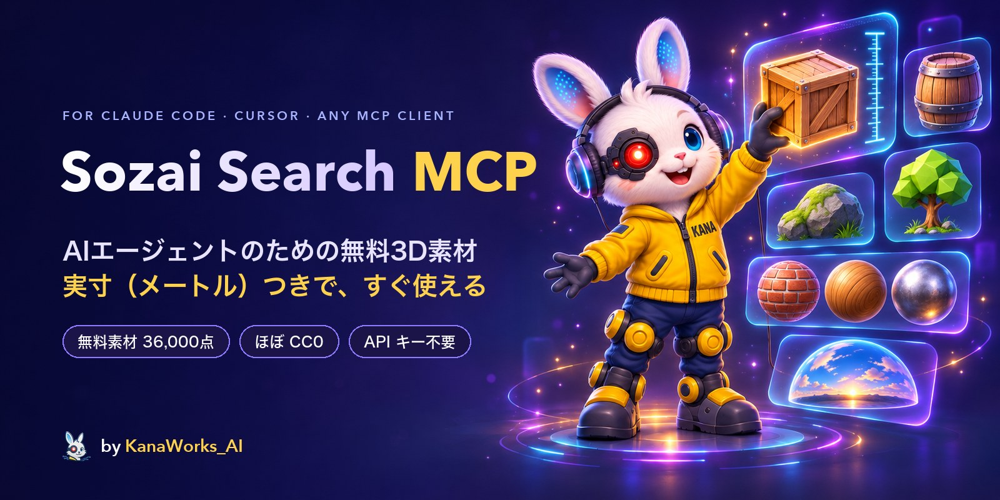

<div align="center">



<p>
  <a href="LICENSE"></a>
  <a href="https://modelcontextprotocol.io"></a>
  
  
  
  <a href="https://github.com/kanaworksai-hue/sozai-search-mcp/actions/workflows/test.yml"></a>
  <a href="https://github.com/kanaworksai-hue/sozai-search-mcp/stargazers"></a>
</p>

<p><a href="https://github.com/kanaworksai-hue"></a>&nbsp;<a href="https://github.com/kanaworksai-hue"><b>KanaWorks_AI のプロジェクト</b></a></p>

[English](README.md) | **日本語** | [简体中文](README.zh-CN.md) | [한국어](README.ko.md) | [Português](README.pt-BR.md) | [Español](README.es.md)

[クイックスタート](#-クイックスタート) · [ツール](#-ツール) · [提供元](#-提供元とライセンス) · [セマンティック検索](#-セマンティック検索オプション) · [FAQ](#-faq) · [⭐ Star で応援](#-star-で応援する)

</div>

**Sozai Search MCP** は、Claude Code、Claude Desktop、Cursor など任意の [MCP](https://modelcontextprotocol.io) クライアントに、**36,000 点の無料 3D 素材**のライブラリを追加します。Poly Haven と ambientCG のフォトリアルなモデル・PBR マテリアル・HDRI、Kenney と Quaternius のローポリなゲーム用モデル、そして Quixel Megascans の掲載情報です。「高さ 1 m 以下の木箱」や「苔むした岩」と頼むと、エージェントがキーワードや意味で検索し、プレビューを見て選び、メートル単位の実寸のままファイルをプロジェクトに置いてくれます。（名前の *Sozai* は日本語の「素材」から取っています。）

Sozai Search はインデックスです。素材ファイルは一切ホストしていません。どの結果も公式の配布元を指していて、ファイルはあなたのマシンが配布元から直接ダウンロードします。

## ✨ 特長

<table>
<tr>
<td align="center" width="25%"><br><b>検索</b><br><sub>キーワードと類義語のほか、意味でも検索。日本語など、どの言語でも OK（「苔むした岩」でも苔の生えた岩が見つかります）</sub></td>
<td align="center" width="25%"><br><b>実寸サイズ</b><br><sub>すべてのサイズをメートルで表記。最大寸法、高さ、ポリゴン数で絞り込み</sub></td>
<td align="center" width="25%"><br><b>すぐ使える</b><br><sub>モデルは <code>.glb</code> 1 つに。PBR フォルダ、HDRI、<code>CREDITS.md</code> 付き</sub></td>
<td align="center" width="25%"><br><b>無料</b><br><sub>ほとんどが CC0。<code>redistributable_only</code> で再配布できる素材だけに絞れます</sub></td>
</tr>
</table>

- **選ぶ前に見る：** `view_assets` でエージェントに最大 8 件のプレビューを見せるので、タイトルではなく見た目で選べます。
- **正しいサイズで届く：** キットのモデルはメートル単位に校正済み（ドアは 2.1 m、人は 1.75 m）で、スケールを合わせた状態で届きます。リグやアニメーションもそのまま使えます。
- **軽量：** サーバーは標準ライブラリだけで書かれた Python で、実行時の依存関係はありません。起動は約 25 ms、待機中のメモリは約 23 MB で、呼び出しの間に状態を持ちません。
- **信頼できないデータでも安全：** 通信は https のみで、接続先は各ライブラリの公式ホストだけです。パスはすべて指定したフォルダの中に収まり、あなたのファイルを削除することはありません。

## 🧭 しくみ

```
「高さ 1 m 以下の木箱」
   └─ search_assets   キーワード + 意味で検索。種類、サイズ、高さ、ポリゴン数、ライセンスで絞り込み
   └─ view_assets     エージェントが候補のプレビューを見る
   └─ fetch_asset     Poly Haven / ambientCG（またはローカルのキット zip）からダウンロードし、
                      実寸の .glb 1 つにまとめて、クレジットを CREDITS.md に追記
```

`sozai build` は公開データを一度だけダウンロードします。全ライブラリのレコード（各素材が何か、サイズ、ライセンス、入手先）と検索用ベクトルをまとめた zip 1 つで、素材ファイルやプレビューは含みません。

## 🚀 クイックスタート

### 🤖 AI エージェントにインストールしてもらう

このリポジトリの URL を Claude Code や Codex などのエージェントに渡して、「Sozai Search MCP をインストールして」と頼んでください。エージェントは次の手順で進めます（手作業でも同じです）。

1. **uv：** `uv --version` で確認し、なければインストールします。
   - macOS / Linux: `curl -LsSf https://astral.sh/uv/install.sh | sh`
   - Windows: `powershell -ExecutionPolicy ByPass -c "irm https://astral.sh/uv/install.ps1 | iex"`
2. **サーバーを登録：** ユーザー自身のプロジェクトのフォルダで実行します。clone は不要で、uv が GitHub から Sozai Search を取得します。

   ```bash
   # Claude Code：このプロジェクトだけに登録（.mcp.json に書き込みます）
   claude mcp add sozai -s project -- uvx --from git+https://github.com/kanaworksai-hue/sozai-search-mcp sozai

   # Codex：すべてのプロジェクトに登録（~/.codex/config.toml に書き込みます）
   codex mcp add sozai -- uvx --from git+https://github.com/kanaworksai-hue/sozai-search-mcp sozai
   ```

   その他のクライアント（Claude Desktop、Cursor など）は、同じコマンドを JSON の設定に書きます。

   ```json
   {"mcpServers": {"sozai": {"command": "uvx", "args": ["--from", "git+https://github.com/kanaworksai-hue/sozai-search-mcp", "sozai"]}}}
   ```

3. **新しいセッションを開始：** MCP サーバーはセッションの開始時に読み込まれます。Claude Code は初回にプロジェクトの `.mcp.json` の承認を求めます。`claude mcp list` または `codex mcp list` で確認できます。
4. **試す：** 「wooden crate」で検索します。最初の検索で公開データ（約 13 MB）をダウンロードし、数秒でインデックスを作ります。`fetch_asset` にはプロジェクト内のフォルダを絶対パスで指定します。
5. **意味で検索（オプション）：** 説明文やどの言語のクエリにも対応させるには、クエリ用モデル（約 350 MB）を一度だけダウンロードします。

   ```bash
   uvx --from "sozai-search-mcp[semantic] @ git+https://github.com/kanaworksai-hue/sozai-search-mcp" sozai semantic-setup
   ```

   そのうえで、`--from git+https://github.com/kanaworksai-hue/sozai-search-mcp` の代わりに `--from "sozai-search-mcp[semantic] @ git+https://github.com/kanaworksai-hue/sozai-search-mcp"` で登録します。

### 🛠️ clone して使う

[uv](https://docs.astral.sh/uv/) が必要です（Python 3.10 以降は uv が用意してくれます）。

```bash
git clone https://github.com/kanaworksai-hue/sozai-search-mcp
cd sozai-search-mcp
uv sync
uv run sozai build            # 公開データ（zip 1 つ、素材ファイルなし）をダウンロードしてインデックス化
uv run sozai search "wooden crate" --kind model
uv run sozai fetch polyhaven:wooden_crate_01 ./assets --quality web
```

**Claude Code**（1 つのプロジェクトだけに登録）：

```bash
claude mcp add sozai -s project -- uv run --directory /path/to/sozai-search-mcp sozai
```

**その他の MCP クライアント**（Claude Desktop、Cursor など）：

```json
{
  "mcpServers": {
    "sozai": {
      "command": "uv",
      "args": ["run", "--directory", "/path/to/sozai-search-mcp", "sozai"]
    }
  }
}
```

clone しなくても、uv で GitHub から直接実行できます：`uvx --from git+https://github.com/kanaworksai-hue/sozai-search-mcp sozai`。`sozai build` をまだ実行していなければ、最初の検索でインデックスが作られます。MCP サーバーはプロジェクトのフォルダで動いているわけではないので、`fetch_asset` には保存先フォルダを絶対パスで指定してください。

## 🧰 ツール

| ツール | できること |
|---|---|
| `search_assets` | 英語のキーワードと類義語で検索し、種類、スタイル、提供元、メートル単位のサイズと高さ、ポリゴン数、タイル可能か、リグ付きか、アニメーション付きか、`redistributable_only`（オープンなプロジェクトで配布してよい CC0 ファイル）で絞り込みます。結果は短くまとめて返します。 |
| `get_asset` | レコードの全項目を返します：サイズ、マップ、タグ、ライセンス、クレジット、ダウンロード方法。 |
| `view_assets` | 最大 8 件の候補のプレビュー画像を表示します。Megascans のプレビューは、求められたときにリンクプレビューと同じ要領で素材の Fab ページから読み取り、一度読んだものは保存しておきます。 |
| `fetch_asset` | ファイルをフォルダに置きます。モデルは `.glb` 1 つ、マテリアルは PBR マップのフォルダ（Poly Haven には実際のタイルサイズを記した `material.json`、ambientCG にはそのまま使える `.tres` / `.mtlx` / `.blend` マテリアルが付きます）、HDRI は `.hdr` / `.exr` です。クレジットを `CREDITS.md` に追記します。追加・置き換えするのはその素材自身のファイルだけです。 |
| `update_index` | ローカルのインデックスを作り直します。このバージョンの Sozai Search が新しい公開データを必要とする場合は、そのダウンロードも行います。 |

サイズはメートル単位の `[width, height, depth]`（幅、高さ、奥行き）で、height が上方向の軸です。マテリアルは、テクスチャ 1 タイルが覆う範囲の `[width, height]` を返します。

## 📚 提供元とライセンス

| ライブラリ | 内容 | ライセンス | ファイル |
|---|---|---|---|
| [Poly Haven](https://polyhaven.com) | フォトリアルなモデル、マテリアル、HDRI | CC0 | Poly Haven からダウンロード。**Powered by Poly Haven.** |
| [ambientCG](https://ambientcg.com) | マテリアル、HDRI、デカール、モデル | CC0 | ambientCG からダウンロード |
| [Kenney](https://kenney.nl) | ローポリのゲーム用キット | CC0 | 自分でダウンロードしたキットの zip から（[後述](#-キットライブラリkenneyquaternius)） |
| [Quaternius](https://quaternius.com) | ローポリのモデル。リグ付き・アニメーション付きも多数 | CC0 | 自分でダウンロードしたキットの zip から |
| [Quixel Megascans](https://www.fab.com/sellers/Quixel) | フォトリアルなスキャン | Fab Standard License | Sozai Search ではダウンロード不可。結果は Fab へのリンク |

Megascans は Fab で無料です。Epic アカウントで入手（claim）してからダウンロードしてください。自分のプロジェクトでは使えますが、ファイルの再配布はできません。掲載情報の 3 つの寸法は軸の順序が決まっていないため、`dims_m`（大きい順）として返し、高さのフィルターには使いません。

データリリースに接続できない場合、`sozai build` は各ライブラリの API を直接読みに行きます。対象は Poly Haven と ambientCG（約 5,300 点）で、キットのレコード、Megascans、セマンティック検索は含まれません。リリース後に追加された素材を取り込みたいときは、`sozai build --live` で同じことを意図的に行えます。Sozai Search を更新すると、最初の検索で新しいバージョンが必要とするデータリリースに切り替わります。

## 🔎 セマンティック検索（オプション）

```bash
uv sync --extra semantic
uv run sozai semantic-setup   # クエリ用モデルを一度だけダウンロード（約 350 MB）
uv run sozai build            # 未実行なら：素材のベクトルは公開データに含まれています
```

モデルを読み込めるよう、extra 付きでサーバーを登録してください：`uv run --directory /path/to/sozai-search-mcp --extra semantic sozai`（JSON の設定では `"sozai"` の前に `"--extra", "semantic"` を追加します）。

これで、どの言語でも意味で検索できるようになります。たとえば「中世の酒場で座るもの」でスツールやベンチが見つかります。各素材には言葉のベクトルと、プレビューがあれば画像のベクトルがあるので（[EmbeddingGemma 2](https://huggingface.co/google/embeddinggemma-2)、テキストと画像を同じ空間で扱います）、名前だけでは何かわからないキットのモデルも、見た目から見つかります。最終的な順位は、キーワード、テキスト、画像の 3 つのランキングを統合して決めます。

検索時に動くのはクエリの処理だけです。テキストモデルを ONNX int8 で CPU 上で動かし、約 45 ms で終わります。モデルは特定のリビジョンに固定し、SHA-256 で検証しています。最初の検索で起動するワーカープロセスで動き、5 分間使われないと終了するので、待機中のサーバーは軽いままです。

## 🧩 キットライブラリ（Kenney、Quaternius）

これらのライブラリには API がありません。モデルは公開データに載っていますが、`fetch_asset` で取り出せるのは、キットをダウンロードして取り込んだ（ingest）後だけです：

```bash
uv run sozai ingest kenney ~/Downloads/kenney-kits
uv run sozai ingest quaternius ~/Downloads/quaternius-packs
```

Kenney の zip はダウンロードしたときの名前のままにしてください（`kenney_city-kit-commercial_2.1.zip`）。Quaternius の zip は `quaternius_<pack>.zip` という名前にします。`<pack>` はパックのページのアドレス（`quaternius.com/packs/<pack>.html`）にある名前で、`_fbx` や `_part2` のような接尾辞は付いていてもかまいません。こうしておくと、取り込んだモデルが公開レコードと置き換わり、二重に表示されません。

すべてのモデルは計測され（サイズ、三角形数、リグ、アニメーション）、キットのプレビュー画像が付きます。FBX しかないモデルは、Blender がインストールされていれば GLB に変換されます（リグとアニメーションクリップも保持されます）。プレビューのないモデルには、ヘッドレスの Blender でプレビューを描画します。信頼できる基準オブジェクトがあるキットはメートル単位に校正されます。基準のないキットはファイルの単位を `attributes.size_units` に記録してサイズを返さないので、サイズフィルターがメートルと取り違えることはありません。ライセンスファイルが CC0 でないキットは、そのファイルへの参照付きで記録され、`redistributable_only` からは除外されます。

## ⚙️ 設定

環境変数（すべて任意）：

| 変数 | 効果 |
|---|---|
| `SOZAI_HOME` | インデックス、データ、モデル、キャッシュの保存場所（既定：`~/Library/Application Support/sozai`、`%LOCALAPPDATA%\sozai`、または `~/.local/share/sozai`）。 |
| `SOZAI_SEMANTIC=0` | semantic extra をインストールしていても、キーワード検索だけを使います。 |
| `SOZAI_FAB_PREVIEWS=0` | Megascans のプレビューのために Fab ページを読みに行きません。 |
| `SOZAI_BLENDER` / `BLENDER_PATH` | `sozai ingest` が使う Blender の実行ファイル。自動で見つからないときに指定します。 |

Sozai Search の接続は https のみで、接続先は上記のライブラリ、GitHub（データリリース）、Hugging Face（クエリ用モデル）だけです。

## ❓ FAQ

<details>
<summary><b>素材を商用のゲームや動画に使えますか？</b></summary>

Poly Haven、ambientCG、Kenney、Quaternius の素材は CC0 なので、どんな用途にも無料で使え、クレジットも不要です（それでも Sozai Search は `CREDITS.md` を書き出します。また Poly Haven は、API 経由で同社の素材を表示する場所に「Powered by Poly Haven」と記載するよう求めています）。Megascans は Fab Standard License で、自分のプロジェクトでは使えますが、ファイルの再配布はできません。すべての結果にライセンスが明記されています。
</details>

<details>
<summary><b>オープンソースのプロジェクトにファイルを同梱できますか？</b></summary>

`redistributable_only=true` で検索してください。CC0 の素材だけが残り、Megascans は除外されます。
</details>

<details>
<summary><b>Sozai Search が Megascans をダウンロードできないのはなぜですか？</b></summary>

Megascans をダウンロードできるのは、素材を（無料で）入手した Fab アカウントの持ち主だけだからです。Sozai Search はエージェントに Fab のリンクを渡し、エージェントがそれをあなたに伝えます。
</details>

<details>
<summary><b>GPU や API キーは必要ですか？</b></summary>

いいえ。キーワード検索は普通の SQLite で、セマンティック検索は CPU で小さなモデルを動かすだけです。アカウントもキーも一切不要です。
</details>

<details>
<summary><b>キットのモデルに「download the kit」と出るのはなぜですか？</b></summary>

Kenney と Quaternius が公開しているのは API ではなく zip だからです。Sozai Search が示すリンクからキットをダウンロードして `sozai ingest` を実行すれば、`fetch_asset` がその zip から直接モデルを取り出します。
</details>

## ⭐ Star で応援する

Sozai Search で見つけた素材を実際に使ってもらえたなら、[リポジトリページ](https://github.com/kanaworksai-hue/sozai-search-mcp)上部の **⭐ Star** を押してもらえるとうれしいです。無料で 1 秒で終わりますが、効果は見た目以上です：

- **もっと多くの人に届きます。** Star が増えるほど GitHub 上で見つけてもらいやすくなります。
- **更新の励みになります。** Star は「使っている人がいる」という何よりのサインです。

ほかの応援方法：不具合やアイデアは [Issue](https://github.com/kanaworksai-hue/sozai-search-mcp/issues) へどうぞ。作ったものを X でシェアして [@KanaWorks_AI](https://x.com/KanaWorks_AI) を付けてもらえるのも大歓迎です。

## 🛠️ 開発

```bash
uv run pytest                 # オフラインテスト
uv run python eval/run.py     # 評価用クエリで検索品質を測定（ビルド済みのインデックスが必要）
```

```
src/sozai/
  server.py        MCP ツールとコマンドライン
  protocol.py      stdio 上の MCP（標準ライブラリのみ）
  search.py        キーワード + セマンティックのランキング、フィルター
  semantic.py      クエリ用モデルのワーカー（ONNX）とそのクライアント
  index.py         SQLite のインデックス
  build.py         公開データまたは各ライブラリの API からインデックスを構築
  bundle.py        公開データの zip（pack / install）
  fetch.py         ダウンロード、.glb へのパック、クレジット
  catalog.py       キットの取り込み（Kenney、Quaternius）。scale.py は校正、thumbs.py はプレビュー
  sources/         Poly Haven、ambientCG、Megascans
```

メンテナーは `sozai build --live`、`sozai ingest ...`、`sozai embed`（MLX、`uv sync --extra embed`）、`sozai pack` でデータリリースを作成します。

## 📄 ライセンスとクレジット

- **このプロジェクト：** [MIT](LICENSE)、© 東京AI映像合同会社
- **素材：** 各素材にはそれぞれのライセンスがあり、結果ごとに明記されています。Sozai Search は素材ファイルを一切配布しません。公開データには専用の `NOTICE.txt` が含まれています。
- **ブランド：** KanaWorks_AI の名称、ロゴ、Kana のキャラクターの権利は東京AI映像合同会社に帰属し、MIT ライセンスの対象**外**です。詳しくは [docs/brand](docs/brand/README.md) を参照してください。
- **使用している技術・データ：** [Poly Haven](https://polyhaven.com)（Powered by Poly Haven）、[ambientCG](https://ambientcg.com)、[Kenney](https://kenney.nl)、[Quaternius](https://quaternius.com)、[EmbeddingGemma 2](https://huggingface.co/google/embeddinggemma-2)、[Model Context Protocol](https://modelcontextprotocol.io)

本プロジェクトは独立したプロジェクトであり、Epic Games、Quixel、Poly Haven、ambientCG、Kenney、Quaternius、Google、Anthropic とは関係がなく、その承認も受けていません。

<br>

<div align="center">

<a href="https://x.com/KanaWorks_AI"></a>

<p><b><a href="https://x.com/KanaWorks_AI">KanaWorks_AI</a> が ♥ を込めて制作</b></p>

<p><sub>Sozai Search で手間が省けたら、⭐ で応援してください。更新の励みになり、他の人にも見つけてもらいやすくなります。ほかのプロジェクト：<a href="https://github.com/kanaworksai-hue">github.com/kanaworksai-hue</a></sub></p>

</div>
