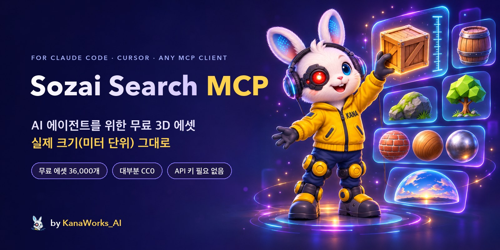

<div align="center">



<p>
  <a href="LICENSE"></a>
  <a href="https://modelcontextprotocol.io"></a>
  
  
  
  <a href="https://github.com/kanaworksai-hue/sozai-search-mcp/actions/workflows/test.yml"></a>
  <a href="https://github.com/kanaworksai-hue/sozai-search-mcp/stargazers"></a>
</p>

<p><a href="https://github.com/kanaworksai-hue"></a>&nbsp;<a href="https://github.com/kanaworksai-hue"><b>A KanaWorks_AI project</b></a></p>

[English](README.md) | [日本語](README.ja.md) | [简体中文](README.zh-CN.md) | **한국어** | [Português](README.pt-BR.md) | [Español](README.es.md)

[시작하기](#-시작하기) · [도구](#-도구) · [출처](#-출처와-라이선스) · [시맨틱 검색](#-시맨틱-검색-선택-사항) · [자주 묻는 질문](#-자주-묻는-질문) · [⭐ 스타 누르기](#-스타로-응원하기)

</div>

**Sozai Search MCP**는 Claude Code, Claude Desktop, Cursor를 비롯한 모든 [MCP](https://modelcontextprotocol.io) 클라이언트에 **무료 3D 에셋 38,000개**의 라이브러리를 제공합니다. Poly Haven과 ambientCG의 실사 모델, PBR 머티리얼, HDRI, Kenney, Quaternius, KayKit, Polygonal Mind의 로우폴리 게임 모델, Open Source Avatars의 리깅된 VRM 아바타, 그리고 Quixel Megascans 에셋 정보까지 담겨 있습니다. "높이 1 m 미만의 나무 상자"나 "이끼 낀 바위"를 요청하면 에이전트가 키워드나 의미로 검색하고, 미리보기를 확인한 뒤, 실제 크기(미터 단위) 그대로 파일을 프로젝트에 넣어 줍니다. (*Sozai*는 일본어 素材로, '소재'라는 뜻입니다.)

Sozai Search는 인덱스입니다. 에셋 파일은 하나도 호스팅하지 않습니다. 모든 결과는 공식 출처를 가리키며, 파일은 여러분의 컴퓨터가 그곳에서 직접 내려받습니다.

## ✨ 주요 기능

<table>
<tr>
<td align="center" width="25%"><br><b>검색</b><br><sub>키워드와 동의어, 또는 어떤 언어로든 의미로 검색("이끼 낀 바위"로 검색해도 mossy rock 에셋이 나옴)</sub></td>
<td align="center" width="25%"><br><b>실제 크기</b><br><sub>모든 크기를 미터로 표시. 최대 치수, 높이, 폴리곤 수로 필터링</sub></td>
<td align="center" width="25%"><br><b>바로 사용</b><br><sub>모델당 <code>.glb</code> 하나, PBR 폴더, HDRI, 그리고 <code>CREDITS.md</code></sub></td>
<td align="center" width="25%"><br><b>무료</b><br><sub>대부분 CC0. <code>redistributable_only</code>로 재배포 가능한 것만 남김</sub></td>
</tr>
</table>

- **보고 나서 고릅니다:** `view_assets`가 에이전트에게 미리보기를 최대 8장까지 보여 주므로, 제목이 아니라 눈으로 보고 선택합니다.
- **알맞은 크기로 도착합니다:** 키트 모델은 미터 단위로 보정되어(문은 2.1 m, 사람은 1.75 m) 스케일이 맞춰진 상태로 전달되며, 리그와 애니메이션도 그대로 동작합니다.
- **가볍습니다:** 서버는 런타임 의존성이 없는 표준 라이브러리 Python입니다. 약 25 ms 만에 시작하고, 대기 중 메모리는 약 23 MB이며, 호출 사이에 상태를 유지하지 않습니다.
- **신뢰할 수 없는 데이터에도 안전합니다:** 각 라이브러리의 공식 호스트에만 https로 접속하고, 모든 경로는 지정한 폴더 안에 머물며, 여러분의 파일은 절대 삭제하지 않습니다.

## 🧭 작동 방식

```
"a wooden crate under 1 m tall"
   └─ search_assets   keywords + meaning, filtered by kind, size, height, polycount, licence
   └─ view_assets     the agent looks at the candidates' previews
   └─ fetch_asset     downloads from Poly Haven / ambientCG (or your local kit zip),
                      packs one .glb at real scale, appends the credit to CREDITS.md
```

`sozai build`는 공개 데이터를 한 번만 내려받습니다. 모든 라이브러리의 레코드(각 에셋이 무엇인지, 크기, 라이선스, 받을 수 있는 곳)와 검색 벡터를 담은 zip 하나이며, 에셋 파일이나 미리보기는 포함되지 않습니다.

## 🚀 시작하기

### 🤖 AI 에이전트에게 설치 맡기기

이 저장소의 URL을 Claude Code, Codex 같은 에이전트에게 주고 "Sozai Search MCP를 설치해 줘"라고 요청하세요. 에이전트는 아래 순서로 진행합니다(직접 설치할 때도 같습니다).

1. **uv:** `uv --version`으로 확인하고, 없으면 설치합니다.
   - macOS / Linux: `curl -LsSf https://astral.sh/uv/install.sh | sh`
   - Windows: `powershell -ExecutionPolicy ByPass -c "irm https://astral.sh/uv/install.ps1 | iex"`
2. **서버 등록:** 사용자 본인의 프로젝트 폴더에서 실행합니다. clone은 필요 없고, uv가 GitHub에서 Sozai Search를 가져옵니다.

   ```bash
   # Claude Code: 이 프로젝트에만 등록(.mcp.json에 기록)
   claude mcp add sozai -s project -- uvx --from git+https://github.com/kanaworksai-hue/sozai-search-mcp sozai

   # Codex: 모든 프로젝트에 등록(~/.codex/config.toml에 기록)
   codex mcp add sozai -- uvx --from git+https://github.com/kanaworksai-hue/sozai-search-mcp sozai
   ```

   다른 클라이언트(Claude Desktop, Cursor 등)는 같은 명령을 JSON 설정에 적습니다.

   ```json
   {"mcpServers": {"sozai": {"command": "uvx", "args": ["--from", "git+https://github.com/kanaworksai-hue/sozai-search-mcp", "sozai"]}}}
   ```

3. **새 세션 시작:** MCP 서버는 세션이 시작될 때 불러옵니다. Claude Code는 처음에 프로젝트의 `.mcp.json`을 승인해 달라고 묻습니다. `claude mcp list` 또는 `codex mcp list`로 확인할 수 있습니다.
4. **써 보기:** "wooden crate"로 검색합니다. 첫 검색에서 공개 데이터(약 13 MB)를 내려받고 몇 초 만에 인덱스를 만듭니다. `fetch_asset`에는 프로젝트 안의 폴더를 절대 경로로 지정합니다.
5. **의미로 검색(선택):** 설명형 질의나 모든 언어의 질의를 쓰려면 질의용 모델(약 350 MB)을 한 번 내려받습니다.

   ```bash
   uvx --from "sozai-search-mcp[semantic] @ git+https://github.com/kanaworksai-hue/sozai-search-mcp" sozai semantic-setup
   ```

   그다음 `--from git+https://github.com/kanaworksai-hue/sozai-search-mcp` 대신 `--from "sozai-search-mcp[semantic] @ git+https://github.com/kanaworksai-hue/sozai-search-mcp"`으로 등록합니다.

### 🛠️ clone해서 쓰기

[uv](https://docs.astral.sh/uv/)가 필요합니다(Python 3.10 이상도 함께 준비해 줍니다).

```bash
git clone https://github.com/kanaworksai-hue/sozai-search-mcp
cd sozai-search-mcp
uv sync
uv run sozai build            # downloads the published data (one zip, no asset files) and indexes it
uv run sozai search "wooden crate" --kind model
uv run sozai fetch polyhaven:wooden_crate_01 ./assets --quality web
```

**Claude Code** (해당 프로젝트에만 등록):

```bash
claude mcp add sozai -s project -- uv run --directory /path/to/sozai-search-mcp sozai
```

**그 밖의 MCP 클라이언트** (Claude Desktop, Cursor, ...):

```json
{
  "mcpServers": {
    "sozai": {
      "command": "uv",
      "args": ["run", "--directory", "/path/to/sozai-search-mcp", "sozai"]
    }
  }
}
```

클론하지 않고 uv로 GitHub에서 바로 실행할 수도 있습니다: `uvx --from git+https://github.com/kanaworksai-hue/sozai-search-mcp sozai`. `sozai build`를 아직 실행하지 않았다면 첫 검색 때 인덱스를 만듭니다. `fetch_asset`에는 절대 경로로 폴더를 지정하세요. MCP 서버는 프로젝트 폴더에서 실행되지 않기 때문입니다.

## 🧰 도구

| 도구 | 하는 일 |
|---|---|
| `search_assets` | 영어 키워드와 동의어로 검색하고, 종류, 스타일, 출처, 크기와 높이(미터), 폴리곤 수, 타일링 가능 여부, 리그, 애니메이션, `redistributable_only`(오픈 프로젝트에 포함해 배포할 수 있는 CC0 파일)로 필터링합니다. 결과는 짧게 반환합니다. |
| `get_asset` | 전체 레코드: 크기, 맵, 태그, 라이선스, 크레딧, 다운로드 방법. |
| `view_assets` | 후보 최대 8개의 미리보기 이미지를 보여 줍니다. Megascans 미리보기는 요청이 있을 때 링크 미리보기처럼 에셋의 Fab 페이지에서 읽어 오며, 한 번 읽은 것은 기억해 둡니다. |
| `fetch_asset` | 파일을 폴더에 넣습니다. 모델은 `.glb` 하나로, 머티리얼은 PBR 맵 폴더로(Poly Haven은 실제 타일 크기를 담은 `material.json`을, ambientCG는 바로 쓸 수 있는 `.tres` / `.mtlx` / `.blend` 머티리얼을 추가), HDRI는 `.hdr` / `.exr`로 저장합니다. 크레딧을 `CREDITS.md`에 추가합니다. 해당 에셋의 파일만 추가하거나 교체합니다. |
| `update_index` | 로컬 인덱스를 다시 빌드합니다. 현재 버전의 Sozai Search가 더 새로운 공개 데이터를 필요로 하면 내려받습니다. |

크기는 미터 단위의 `[width, height, depth]`이며, height가 위쪽 축입니다. 머티리얼은 텍스처 타일 하나가 덮는 면적을 `[width, height]`로 나타냅니다.

## 📚 출처와 라이선스

| 라이브러리 | 내용 | 라이선스 | 파일 |
|---|---|---|---|
| [Poly Haven](https://polyhaven.com) | 실사 모델, 머티리얼, HDRI | CC0 | Poly Haven에서 다운로드. **Powered by Poly Haven.** |
| [ambientCG](https://ambientcg.com) | 머티리얼, HDRI, 데칼, 모델 | CC0 | ambientCG에서 다운로드 |
| [Kenney](https://kenney.nl) | 로우폴리 게임 키트 | CC0 | 직접 내려받은 키트 zip에서 가져옴([아래 참고](#-키트-라이브러리-kenney-quaternius)) |
| [Quaternius](https://quaternius.com) | 로우폴리 모델, 다수가 리그와 애니메이션 포함 | CC0 | 직접 내려받은 키트 zip에서 가져옴 |
| [KayKit](https://kaylousberg.com) | 로우폴리 게임 팩: 캐릭터, 던전, 가구, 레스토랑, 핼러윈 등 | CC0 | GitHub에서 다운로드 |
| [Polygonal Mind](https://github.com/PolygonalMind/initiative-opensource-release) | 메타버스 월드의 로우폴리 소품과 배경(GLB 버전: [ToxSam](https://github.com/ToxSam/cc0-models-Polygonal-Mind)) | CC0 | GitHub에서 다운로드 |
| [Open Source Avatars](https://www.opensourceavatars.com) | 리깅된 휴머노이드 VRM 아바타: Polygonal Mind의 100Avatars(복셀 버전 포함) 등([레지스트리](https://github.com/ToxSam/open-source-avatars)) | CC0 | Arweave에서 다운로드 |
| [Quixel Megascans](https://www.fab.com/sellers/Quixel) | 실사 스캔 | Fab Standard License | Sozai Search로는 다운로드 불가: 결과에 Fab 링크 제공 |

Megascans는 Fab에서 무료입니다. Epic 계정으로 라이브러리에 추가한 뒤 다운로드하세요. 프로젝트에 사용할 수는 있지만 파일을 재배포할 수는 없습니다. 에셋 페이지에 나오는 세 치수는 축 순서가 정해져 있지 않아서 `dims_m`(큰 값부터)으로 표시하고, 높이 필터에서는 제외합니다.

데이터 릴리스에 접속할 수 없으면 `sozai build`는 각 라이브러리의 API를 직접 읽습니다. 대상은 Poly Haven과 ambientCG(약 5,300개 에셋)이며, 키트 레코드, Megascans, 시맨틱 검색은 빠집니다. `sozai build --live`는 릴리스 이후에 추가된 에셋까지 받기 위해 같은 동작을 일부러 수행합니다. Sozai Search를 업데이트하면 첫 검색 때 새 버전이 요구하는 데이터 릴리스로 전환됩니다.

## 🔎 시맨틱 검색 (선택 사항)

```bash
uv sync --extra semantic
uv run sozai semantic-setup   # downloads the query model once (about 350 MB)
uv run sozai build            # if not done yet: the asset vectors come with the published data
```

모델을 불러올 수 있도록 semantic extra를 포함해 서버를 등록하세요: `uv run --directory /path/to/sozai-search-mcp --extra semantic sozai` (JSON 설정에서는 `"sozai"` 앞에 `"--extra", "semantic"`을 추가).

이제 어떤 언어로든 의미로도 검색됩니다. "중세 선술집에서 앉을 만한 것"을 찾으면 스툴과 벤치가 나옵니다. 각 에셋에는 단어의 벡터와, 미리보기가 있다면 이미지의 벡터가 있어서([EmbeddingGemma 2](https://huggingface.co/google/embeddinggemma-2), 텍스트와 이미지가 하나의 공간을 공유), 이름이 간단한 키트 모델도 생김새로 찾을 수 있습니다. 최종 순위는 키워드, 텍스트, 이미지 검색 순위를 합쳐서 정합니다.

검색 시점에 처리하는 것은 쿼리뿐입니다. 텍스트 모델을 CPU에서 ONNX int8로 실행하며 약 45 ms가 걸리고, 특정 리비전에 고정되어 SHA-256으로 검증됩니다. 이 모델은 첫 검색 때 시작되어 5분 동안 유휴 상태면 종료되는 워커 프로세스에서 돌아가므로, 대기 중인 서버는 가벼운 상태를 유지합니다.

## 🧩 키트 라이브러리 (Kenney, Quaternius)

이 라이브러리들에는 API가 없습니다. 모델은 공개 데이터에 등록되어 있지만, `fetch_asset`으로 받으려면 먼저 키트를 내려받아 가져오기(ingest)를 해야 합니다.

```bash
uv run sozai ingest kenney ~/Downloads/kenney-kits
uv run sozai ingest quaternius ~/Downloads/quaternius-packs
```

Kenney의 zip 이름은 내려받은 그대로 두세요(`kenney_city-kit-commercial_2.1.zip`). Quaternius zip은 `quaternius_<pack>.zip`으로 이름을 바꾸세요. `<pack>`은 팩 페이지 주소(`quaternius.com/packs/<pack>.html`)에 들어 있는 이름이며, `_fbx`나 `_part2` 같은 접미사가 붙어 있어도 괜찮습니다. 그러면 가져온 모델이 중복으로 나타나지 않고 공개 레코드를 대체합니다.

모든 모델은 크기, 삼각형 수, 리그, 애니메이션을 측정하고 키트의 미리보기 이미지를 붙입니다. FBX만 있는 모델은 Blender가 설치되어 있으면 GLB로 변환되고(리그와 애니메이션 클립 유지), 미리보기가 없는 모델은 헤드리스 Blender로 미리보기를 렌더링합니다. 신뢰할 수 있는 기준 오브젝트가 있는 키트는 미터 단위로 보정됩니다. 기준 오브젝트가 없는 키트는 파일 단위를 `attributes.size_units`에 남기고 크기를 표시하지 않으므로, 크기 필터가 이를 미터로 오인하는 일이 없습니다. 라이선스 파일이 CC0가 아닌 키트는 해당 파일의 위치와 함께 기록되며 `redistributable_only`에서 제외됩니다.

## ⚙️ 설정

환경 변수(모두 선택 사항):

| 변수 | 효과 |
|---|---|
| `SOZAI_HOME` | 인덱스, 데이터, 모델, 캐시를 저장하는 위치(기본값: `~/Library/Application Support/sozai`, `%LOCALAPPDATA%\sozai`, 또는 `~/.local/share/sozai`). |
| `SOZAI_SEMANTIC=0` | semantic extra가 설치되어 있어도 키워드 검색만 사용합니다. |
| `SOZAI_FAB_PREVIEWS=0` | Megascans 미리보기를 위해 Fab 페이지를 읽지 않습니다. |
| `SOZAI_BLENDER` / `BLENDER_PATH` | Blender를 자동으로 찾지 못할 때 `sozai ingest`가 사용할 Blender 실행 파일. |

Sozai Search는 https로만 접속하며, 접속 대상은 위의 라이브러리, GitHub(데이터 릴리스), Hugging Face(쿼리 모델)뿐입니다.

## ❓ 자주 묻는 질문

<details>
<summary><b>에셋을 상업용 게임이나 영상에 써도 되나요?</b></summary>

Poly Haven, ambientCG, Kenney, Quaternius, KayKit, Polygonal Mind, Open Source Avatars 에셋은 CC0입니다. 어떤 용도로든 무료이고 크레딧도 필요 없습니다(그래도 Sozai Search는 `CREDITS.md`를 작성하며, Poly Haven은 API를 통해 자사 에셋을 보여 줄 때 "Powered by Poly Haven"을 표기해 달라고 요청합니다). Megascans는 Fab Standard License를 따릅니다. 프로젝트에 사용할 수는 있지만 파일을 재배포해서는 안 됩니다. 모든 결과에 라이선스가 표시됩니다.
</details>

<details>
<summary><b>오픈소스 프로젝트에 파일을 포함해 배포해도 되나요?</b></summary>

`redistributable_only=true`로 검색하세요. CC0 에셋만 남기고 Megascans는 제외합니다.
</details>

<details>
<summary><b>Sozai Search는 왜 Megascans를 다운로드하지 못하나요?</b></summary>

Fab 계정 소유자가 (무료로) 라이브러리에 추가한 뒤에만 다운로드할 수 있기 때문입니다. Sozai Search는 여러분에게 전달할 Fab 링크를 에이전트에게 알려 줍니다.
</details>

<details>
<summary><b>GPU나 API 키가 필요한가요?</b></summary>

아니요. 키워드 검색은 일반 SQLite로 처리하고, 시맨틱 검색은 CPU에서 작은 모델을 실행합니다. 계정이나 키는 전혀 필요 없습니다.
</details>

<details>
<summary><b>키트 모델에 "download the kit"이라고 나오는 이유는 뭔가요?</b></summary>

Kenney와 Quaternius는 API가 아니라 zip으로 배포합니다. Sozai Search가 알려 주는 링크에서 키트를 내려받아 `sozai ingest`를 실행하면, `fetch_asset`이 그 zip에서 바로 모델을 꺼내 옵니다.
</details>

## ⭐ 스타로 응원하기

Sozai Search로 찾은 에셋을 실제로 쓰셨다면 [저장소 페이지](https://github.com/kanaworksai-hue/sozai-search-mcp) 오른쪽 위의 **⭐ Star**를 눌러 주세요. 무료이고 1초면 충분하지만, 생각보다 큰 힘이 돼요.

- **더 많은 사람에게 닿아요:** 스타가 많을수록 GitHub에서 다른 사람들이 발견하기 쉬워집니다.
- **업데이트가 계속돼요:** 스타 하나하나가 누군가 이 프로젝트를 유용하게 쓰고 있다는 신호가 되거든요.

버그 제보나 아이디어는 [Issues](https://github.com/kanaworksai-hue/sozai-search-mcp/issues)에, 만든 작품은 X에서 [@KanaWorks_AI](https://x.com/KanaWorks_AI)를 태그해서 공유해 주시면 정말 기쁠 거예요.

## 🛠️ 개발

```bash
uv run pytest                 # offline tests
uv run python eval/run.py     # search quality on the eval queries (needs a built index)
```

```
src/sozai/
  server.py        MCP tools and the command line
  protocol.py      MCP over stdio (standard library only)
  search.py        keyword + semantic ranking, filters
  semantic.py      query model worker (ONNX) and its client
  index.py         the SQLite index
  build.py         builds the index from the published data or the libraries' APIs
  bundle.py        the published data zip (pack / install)
  fetch.py         downloads, packing .glb, credits
  catalog.py       kit ingest (Kenney, Quaternius); scale.py calibration, thumbs.py previews
  repos.py         libraries on GitHub (KayKit, Polygonal Mind, Open Source Avatars)
  sources/         Poly Haven, ambientCG, Megascans
```

메인테이너는 `sozai build --live`, `sozai ingest ...`, `sozai embed`(MLX, `uv sync --extra embed`), `sozai pack`으로 데이터 릴리스를 만듭니다.

## 📄 라이선스 및 크레딧

- **이 프로젝트:** [MIT](LICENSE), © 東京AI映像合同会社 (Tokyo AI Visuals LLC).
- **에셋:** 각 에셋은 고유한 라이선스를 따르며, 결과마다 표시됩니다. Sozai Search는 에셋 파일을 배포하지 않습니다. 공개 데이터에는 별도의 `NOTICE.txt`가 들어 있습니다.
- **브랜드:** KanaWorks_AI라는 이름과 로고, 캐릭터 Kana는 東京AI映像合同会社의 소유이며 MIT 라이선스 적용 대상이 **아닙니다**. 자세한 내용은 [docs/brand](docs/brand/README.md)를 참고하세요.
- **기반 기술:** [Poly Haven](https://polyhaven.com) (Powered by Poly Haven), [ambientCG](https://ambientcg.com), [Kenney](https://kenney.nl), [Quaternius](https://quaternius.com), [KayKit](https://kaylousberg.com), [Polygonal Mind](https://github.com/PolygonalMind/initiative-opensource-release), [Open Source Avatars](https://www.opensourceavatars.com), [EmbeddingGemma 2](https://huggingface.co/google/embeddinggemma-2), [Model Context Protocol](https://modelcontextprotocol.io).

이 프로젝트는 독립 프로젝트이며, Epic Games, Quixel, Poly Haven, ambientCG, Kenney, Quaternius, KayKit, Polygonal Mind, Open Source Avatars, Google, Anthropic과 제휴하거나 보증을 받은 것이 아닙니다.

<br>

<div align="center">

<a href="https://x.com/KanaWorks_AI"></a>

<p><b>Made with ♥ by <a href="https://x.com/KanaWorks_AI">KanaWorks_AI</a></b></p>

<p><sub>Sozai Search 덕분에 시간을 아끼셨다면 ⭐ 하나가 업데이트를 이어 가는 힘이 되고, 다른 사람들이 이 프로젝트를 찾는 데도 도움이 됩니다. 다른 프로젝트: <a href="https://github.com/kanaworksai-hue">github.com/kanaworksai-hue</a></sub></p>

</div>
