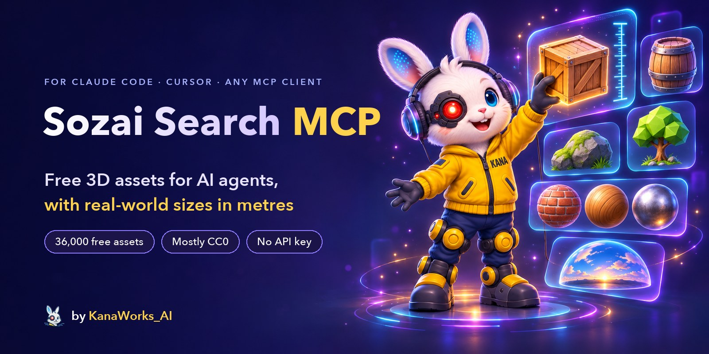

<div align="center">



<p>
  <a href="LICENSE"></a>
  <a href="https://modelcontextprotocol.io"></a>
  
  
  
  <a href="https://github.com/kanaworksai-hue/sozai-search-mcp/actions/workflows/test.yml"></a>
  <a href="https://github.com/kanaworksai-hue/sozai-search-mcp/stargazers"></a>
</p>

<p><a href="https://github.com/kanaworksai-hue"></a>&nbsp;<a href="https://github.com/kanaworksai-hue"><b>A KanaWorks_AI project</b></a></p>

**English** | [日本語](README.ja.md) | [简体中文](README.zh-CN.md) | [한국어](README.ko.md) | [Português](README.pt-BR.md) | [Español](README.es.md)

[Quick start](#-quick-start) · [Tools](#-tools) · [Sources](#-sources-and-licences) · [Semantic search](#-semantic-search-optional) · [FAQ](#-faq) · [⭐ Star](#-like-it-star-it)

</div>

**Sozai Search MCP** gives Claude Code, Claude Desktop, Cursor and any other [MCP](https://modelcontextprotocol.io) client a library of **39,000 free 3D assets**: photoreal models, PBR materials and HDRIs from Poly Haven and ambientCG, low-poly game models from Kenney, Quaternius, KayKit and Polygonal Mind, rigged VRM avatars from Open Source Avatars, NASA spacecraft, rovers and telescopes, and Quixel Megascans listings. Ask for "a wooden crate under 1 m tall" or "a mossy rock"; the agent searches by words or by meaning, looks at the previews, and drops the files into your project, at their real size in metres. (*Sozai*, 素材, means "materials" in Japanese.)

Sozai Search is an index. It hosts no asset files: every result points at the official source, and files are downloaded from there by your own machine.

## ✨ Highlights

<table>
<tr>
<td align="center" width="25%"><br><b>Search</b><br><sub>Keywords and synonyms, or meaning in any language ("苔むした岩" finds mossy rocks)</sub></td>
<td align="center" width="25%"><br><b>Real sizes</b><br><sub>Every size in metres; filter by largest dimension, height and polycount</sub></td>
<td align="center" width="25%"><br><b>Ready to use</b><br><sub>One <code>.glb</code> per model, PBR folders, HDRIs, plus <code>CREDITS.md</code></sub></td>
<td align="center" width="25%"><br><b>Free</b><br><sub>Mostly CC0; <code>redistributable_only</code> keeps what you may ship</sub></td>
</tr>
</table>

- **Looks before it picks:** `view_assets` shows the agent up to 8 previews, so it chooses by eye, not by title.
- **Arrives at the right size:** kit models are calibrated to metres (a door is 2.1 m, a person 1.75 m) and delivered already scaled; rigs and animations keep working.
- **Light:** the server is standard-library Python with no runtime dependencies. It starts in about 25 ms, idles at about 23 MB and holds no state between calls.
- **Safe with untrusted data:** https only, to the libraries' own hosts; every path stays inside the folder you gave; it never deletes your files.

## 🧭 How it works

```
"a wooden crate under 1 m tall"
   └─ search_assets   keywords + meaning, filtered by kind, size, height, polycount, licence
   └─ view_assets     the agent looks at the candidates' previews
   └─ fetch_asset     downloads from Poly Haven / ambientCG (or your local kit zip),
                      packs one .glb at real scale, appends the credit to CREDITS.md
```

`sozai build` downloads the published data once: one zip with every library's records (what each asset is, its size, licence and where to get it) and the search vectors. No asset files, no previews.

## 🚀 Quick start

### 🤖 Install with your AI agent

Give this repository's URL to Claude Code, Codex or another agent and ask it to install Sozai Search MCP. These are the steps it should follow (they work by hand too):

1. **uv:** check `uv --version`; if uv is missing, install it:
   - macOS / Linux: `curl -LsSf https://astral.sh/uv/install.sh | sh`
   - Windows: `powershell -ExecutionPolicy ByPass -c "irm https://astral.sh/uv/install.ps1 | iex"`
2. **Register the server:** run this in the user's own project folder. No clone is needed: uv fetches Sozai Search from GitHub.

   ```bash
   # Claude Code: this project only (writes .mcp.json)
   claude mcp add sozai -s project -- uvx --from git+https://github.com/kanaworksai-hue/sozai-search-mcp sozai

   # Codex: all projects (writes ~/.codex/config.toml)
   codex mcp add sozai -- uvx --from git+https://github.com/kanaworksai-hue/sozai-search-mcp sozai
   ```

   Other clients (Claude Desktop, Cursor, ...) take the same command in their JSON config:

   ```json
   {"mcpServers": {"sozai": {"command": "uvx", "args": ["--from", "git+https://github.com/kanaworksai-hue/sozai-search-mcp", "sozai"]}}}
   ```

3. **Start a new session:** MCP servers load when a session starts. Claude Code asks once to approve the project's `.mcp.json`. Check with `claude mcp list` or `codex mcp list`.
4. **Try it:** search for "wooden crate". The first search downloads the published data (about 15 MB) and builds the index in a few seconds. Give `fetch_asset` an absolute folder inside the project.
5. **Search by meaning (optional, ask the user first):** it makes descriptive queries and queries in any language much better (in our tests the right asset comes first 79% of the time instead of 31%). It needs about 600 MB of disk once: about 250 MB of Python packages and the 350 MB query model. Ask the user whether to turn it on; if they agree, download the query model:

   ```bash
   uvx --from "sozai-search-mcp[semantic] @ git+https://github.com/kanaworksai-hue/sozai-search-mcp" sozai semantic-setup
   ```

   Then register with `--from "sozai-search-mcp[semantic] @ git+https://github.com/kanaworksai-hue/sozai-search-mcp"` in place of `--from git+https://github.com/kanaworksai-hue/sozai-search-mcp`.

### 🛠️ From a clone

You need [uv](https://docs.astral.sh/uv/) (it brings Python 3.10 or newer).

```bash
git clone https://github.com/kanaworksai-hue/sozai-search-mcp
cd sozai-search-mcp
uv sync
uv run sozai build            # downloads the published data (one zip, no asset files) and indexes it
uv run sozai search "wooden crate" --kind model
uv run sozai fetch polyhaven:wooden_crate_01 ./assets --quality web
```

**Claude Code** (registered for one project only):

```bash
claude mcp add sozai -s project -- uv run --directory /path/to/sozai-search-mcp sozai
```

**Any other MCP client** (Claude Desktop, Cursor, ...):

```json
{
  "mcpServers": {
    "sozai": {
      "command": "uv",
      "args": ["run", "--directory", "/path/to/sozai-search-mcp", "sozai"]
    }
  }
}
```

Without a clone, uv can run it straight from GitHub: `uvx --from git+https://github.com/kanaworksai-hue/sozai-search-mcp sozai`. The first search builds the index if `sozai build` has not run yet. Give `fetch_asset` an absolute folder: an MCP server does not run in your project folder.

## 🧰 Tools

| Tool | What it does |
|---|---|
| `search_assets` | English keywords plus synonyms, filtered by kind, style, source, size and height in metres, polycount, tileable, rigged, animated, and `redistributable_only` (CC0 files you may ship in an open project). Short results. |
| `get_asset` | The full record: sizes, maps, tags, licence, credit, how to download. |
| `view_assets` | Shows up to 8 candidates' preview images. Megascans previews are read from the asset's Fab page when asked for, like a link preview, and remembered. |
| `fetch_asset` | Puts the files in a folder: a model as one `.glb`, a material as a folder of PBR maps (Poly Haven adds `material.json` with the real tile size, ambientCG ready-made `.tres` / `.mtlx` / `.blend` materials), an HDRI as `.hdr` / `.exr`. Adds the credit to `CREDITS.md`. It only adds or replaces the asset's own files. |
| `update_index` | Rebuilds the local index, downloading newer published data when this version of Sozai Search expects it. |

Sizes are `[width, height, depth]` in metres, height being the up axis. Materials give `[width, height]` of the area one texture tile covers.

## 📚 Sources and licences

| Library | What | Licence | Files |
|---|---|---|---|
| [Poly Haven](https://polyhaven.com) | Photoreal models, materials, HDRIs | CC0 | Downloaded from Poly Haven. **Powered by Poly Haven.** |
| [ambientCG](https://ambientcg.com) | Materials, HDRIs, decals, models | CC0 | Downloaded from ambientCG |
| [Kenney](https://kenney.nl) | Low-poly game kits | CC0 | From kit zips you download ([below](#-kit-libraries-kenney-quaternius)) |
| [Quaternius](https://quaternius.com) | Low-poly models, many rigged and animated | CC0 | From kit zips you download |
| [KayKit](https://kaylousberg.com) | Low-poly game packs: characters, dungeon, furniture, restaurant, Halloween | CC0 | Downloaded from GitHub |
| [Polygonal Mind](https://github.com/PolygonalMind/initiative-opensource-release) | Low-poly props and scenery from metaverse worlds (GLB versions by [ToxSam](https://github.com/ToxSam/cc0-models-Polygonal-Mind)) | CC0 | Downloaded from GitHub |
| [Open Source Avatars](https://www.opensourceavatars.com) | Rigged humanoid VRM avatars: 100Avatars by Polygonal Mind (plus voxel versions) and more ([registry](https://github.com/ToxSam/open-source-avatars)) | CC0 | Downloaded from Arweave |
| [NASA 3D Resources](https://science.nasa.gov/3d-resources/) | Spacecraft, rovers, telescopes, rockets, asteroids and astronaut gear ([repository](https://github.com/nasa/NASA-3D-Resources)); no size in metres, as the files share no unit | [NASA media guidelines](https://www.nasa.gov/nasa-brand-center/images-and-media/) | Downloaded from GitHub |
| [Quixel Megascans](https://www.fab.com/sellers/Quixel) | Photoreal scans | Fab Standard License | Not downloadable by Sozai Search: results link to Fab |

Megascans are free on Fab: claim them with an Epic account, then download. You may use them in your projects but not redistribute the files. A listing's three dimensions come in no fixed axis order, so they are reported as `dims_m` (largest first) and kept out of height filters.

If the data release cannot be reached, `sozai build` reads the libraries' APIs directly: Poly Haven and ambientCG (about 5,300 assets), without kit records, Megascans or semantic search. `sozai build --live` does the same on purpose, for assets newer than the release. After you update Sozai Search, the first search moves to the data release the new version expects.

## 🔎 Semantic search (optional)

```bash
uv sync --extra semantic
uv run sozai semantic-setup   # downloads the query model once (about 350 MB)
uv run sozai build            # if not done yet: the asset vectors come with the published data
```

Register the server with the extra so it can load the model: `uv run --directory /path/to/sozai-search-mcp --extra semantic sozai` (in a JSON config, add `"--extra", "semantic"` before `"sozai"`).

Search then also matches by meaning, in any language: "something to sit on in a medieval tavern" finds stools and benches. Each asset has a vector of its words and, when it has a preview, of its picture ([EmbeddingGemma 2](https://huggingface.co/google/embeddinggemma-2), one space for text and images), so kit models with bare names are found by what they look like. The ranking fuses the keyword, text and image rankings.

Only the query runs at search time: the text model as ONNX int8 on the CPU, about 45 ms, pinned to one revision and checked by SHA-256. It runs in a worker process that starts with the first search and quits after five idle minutes, so an idle server keeps its small footprint.

## 🧩 Kit libraries (Kenney, Quaternius)

These libraries have no API. Their models are listed in the published data, but `fetch_asset` can deliver them only after you download the kits and ingest them:

```bash
uv run sozai ingest kenney ~/Downloads/kenney-kits
uv run sozai ingest quaternius ~/Downloads/quaternius-packs
```

Keep Kenney's zip names as downloaded (`kenney_city-kit-commercial_2.1.zip`). Name Quaternius zips `quaternius_<pack>.zip`, where `<pack>` is the name in the pack page's address (`quaternius.com/packs/<pack>.html`); suffixes such as `_fbx` or `_part2` are fine. Then the ingested models replace their published records instead of appearing twice.

Every model is measured (size, triangles, rig, animations) and gets the kit's preview image. FBX-only models are converted to GLB with Blender when it is installed (rigs and animation clips are kept), and models without a preview get one rendered by headless Blender. Kits with a trustworthy reference object are calibrated to metres; kits without one keep their file units in `attributes.size_units` and report no size, so size filters never mistake them for metres. A kit whose licence file is not CC0 is recorded with a pointer to that file and left out of `redistributable_only`.

## ⚙️ Configuration

Environment variables, all optional:

| Variable | Effect |
|---|---|
| `SOZAI_HOME` | Where the index, data, model and caches live (default: `~/Library/Application Support/sozai`, `%LOCALAPPDATA%\sozai`, or `~/.local/share/sozai`). |
| `SOZAI_SEMANTIC=0` | Keyword search only, even with the semantic extra installed. |
| `SOZAI_FAB_PREVIEWS=0` | Never read Fab pages for Megascans previews. |
| `SOZAI_BLENDER` / `BLENDER_PATH` | The Blender executable used by `sozai ingest`, when it is not found by itself. |

Sozai Search only connects over https, to the libraries above, GitHub (the data release) and Hugging Face (the query model).

## ❓ FAQ

<details>
<summary><b>Can I use the assets in a commercial game or video?</b></summary>

Poly Haven, ambientCG, Kenney, Quaternius, KayKit, Polygonal Mind and Open Source Avatars assets are CC0: free for any use, no credit required (Sozai Search still writes `CREDITS.md`, and Poly Haven asks for "Powered by Poly Haven" where you show their assets through the API). Megascans are under the Fab Standard License: use them in your projects, but don't redistribute the files. NASA models are not subject to copyright in the US, under NASA's media guidelines: credit NASA, don't imply NASA endorsement, and ask NASA before using its logos or insignia commercially. Every result states its licence.
</details>

<details>
<summary><b>Can I ship the files in an open-source project?</b></summary>

Search with `redistributable_only=true`: it keeps CC0 assets and leaves out Megascans and NASA models (NASA's own terms apply).
</details>

<details>
<summary><b>Why can't Sozai Search download Megascans?</b></summary>

Only the owner of a Fab account can download them, after claiming them (free). Sozai Search gives the agent the Fab link to pass on to you.
</details>

<details>
<summary><b>Does it need a GPU or an API key?</b></summary>

No. Keyword search is plain SQLite; semantic search runs a small model on the CPU. Nothing needs an account or a key.
</details>

<details>
<summary><b>Why does a kit model say "download the kit"?</b></summary>

Kenney and Quaternius publish zips, not an API. Download the kit from the link Sozai Search gives, run `sozai ingest`, and `fetch_asset` takes the model straight from your zip.
</details>

## ⭐ Like it? Star it

If Sozai Search found you an asset you ended up using, please click **⭐ Star** at the top of the [repository page](https://github.com/kanaworksai-hue/sozai-search-mcp). It's free, takes one second, and helps more than it looks:

- **More people find it.** Stars make the project easier to discover on GitHub.
- **It keeps updates coming.** Every star tells me someone finds this useful.

Other ways to help: [open an issue](https://github.com/kanaworksai-hue/sozai-search-mcp/issues) for a bug or an idea, or share what you built on X and tag [@KanaWorks_AI](https://x.com/KanaWorks_AI).

## 🛠️ Development

```bash
uv run pytest                 # offline tests
uv run python eval/run.py     # search quality on the eval queries (needs a built index)
```

```
src/sozai/
  server.py        MCP tools and the command line
  protocol.py      MCP over stdio (standard library only)
  search.py        keyword + semantic ranking, filters
  semantic.py      query model worker (ONNX) and its client
  index.py         the SQLite index
  build.py         builds the index from the published data or the libraries' APIs
  bundle.py        the published data zip (pack / install)
  fetch.py         downloads, packing .glb, credits
  catalog.py       kit ingest (Kenney, Quaternius); scale.py calibration, thumbs.py previews
  repos.py         libraries on GitHub (KayKit, Polygonal Mind, Open Source Avatars, NASA)
  sources/         Poly Haven, ambientCG, Megascans
```

Maintainers make a data release with `sozai build --live`, `sozai ingest ...`, `sozai embed` (MLX, `uv sync --extra embed`) and `sozai pack`.

## 📄 License and credits

- **This project:** [MIT](LICENSE), © 東京AI映像合同会社 (Tokyo AI Visuals LLC).
- **Assets:** each asset keeps its own licence, given per result. Sozai Search distributes no asset files. The published data carries its own `NOTICE.txt`.
- **Brand:** the KanaWorks_AI name, logo and the Kana character are © 東京AI映像合同会社 and are **not** covered by the MIT license. See [docs/brand](docs/brand/README.md).
- **Built on:** [Poly Haven](https://polyhaven.com) (Powered by Poly Haven), [ambientCG](https://ambientcg.com), [Kenney](https://kenney.nl), [Quaternius](https://quaternius.com), [KayKit](https://kaylousberg.com), [Polygonal Mind](https://github.com/PolygonalMind/initiative-opensource-release), [Open Source Avatars](https://www.opensourceavatars.com), [NASA](https://science.nasa.gov/3d-resources/), [EmbeddingGemma 2](https://huggingface.co/google/embeddinggemma-2) and the [Model Context Protocol](https://modelcontextprotocol.io).

This is an independent project. It is not affiliated with or endorsed by Epic Games, Quixel, Poly Haven, ambientCG, Kenney, Quaternius, KayKit, Polygonal Mind, Open Source Avatars, NASA, Google or Anthropic.

<br>

<div align="center">

<a href="https://x.com/KanaWorks_AI"></a>

<p><b>Made with ♥ by <a href="https://x.com/KanaWorks_AI">KanaWorks_AI</a></b></p>

<p><sub>If Sozai Search saves you time, a ⭐ keeps the updates coming and helps others find it. More projects: <a href="https://github.com/kanaworksai-hue">github.com/kanaworksai-hue</a></sub></p>

</div>
