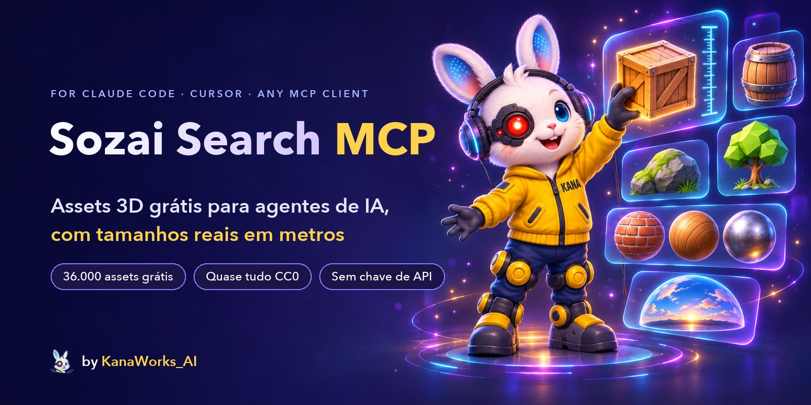
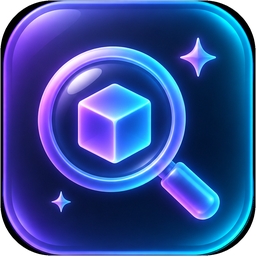
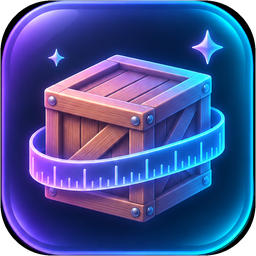
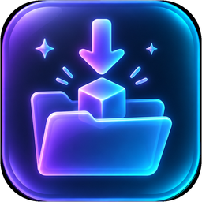
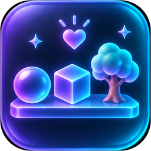

<div align="center">



<p>
  <a href="LICENSE"></a>
  <a href="https://modelcontextprotocol.io"></a>
  
  
  
  <a href="https://github.com/kanaworksai-hue/sozai-search-mcp/actions/workflows/test.yml"></a>
  <a href="https://github.com/kanaworksai-hue/sozai-search-mcp/stargazers"></a>
</p>

<p><a href="https://github.com/kanaworksai-hue"></a>&nbsp;<a href="https://github.com/kanaworksai-hue"><b>Um projeto KanaWorks_AI</b></a></p>

[English](README.md) | [日本語](README.ja.md) | [简体中文](README.zh-CN.md) | [한국어](README.ko.md) | **Português** | [Español](README.es.md)

[Primeiros passos](#-primeiros-passos) · [Ferramentas](#-ferramentas) · [Fontes](#-fontes-e-licenças) · [Busca semântica](#-busca-semântica-opcional) · [Perguntas frequentes](#-perguntas-frequentes) · [⭐ Deixe uma estrela](#-apoie-com-uma-estrela)

</div>

**Sozai Search MCP** dá ao Claude Code, ao Claude Desktop, ao Cursor e a qualquer outro cliente [MCP](https://modelcontextprotocol.io) uma biblioteca de **38.000 assets 3D gratuitos**: modelos fotorrealistas, materiais PBR e HDRIs do Poly Haven e do ambientCG, modelos low-poly para jogos do Kenney, do Quaternius, do KayKit e da Polygonal Mind, avatares VRM com rig do Open Source Avatars, e listagens do Quixel Megascans. Peça "um caixote de madeira com menos de 1 m de altura" ou "uma pedra com musgo": o agente busca por palavras ou por significado, olha as prévias e coloca os arquivos no seu projeto, no tamanho real em metros. (*Sozai*, 素材, significa "materiais" em japonês.)

O Sozai Search é um índice. Ele não hospeda nenhum arquivo de asset: cada resultado aponta para a fonte oficial, e os arquivos são baixados de lá pela sua própria máquina.

## ✨ Destaques

<table>
<tr>
<td align="center" width="25%"><br><b>Busca</b><br><sub>Palavras-chave e sinônimos, ou significado em qualquer idioma ("苔むした岩" encontra pedras com musgo)</sub></td>
<td align="center" width="25%"><br><b>Tamanhos reais</b><br><sub>Todos os tamanhos em metros; filtre pela maior dimensão, pela altura e pela contagem de polígonos</sub></td>
<td align="center" width="25%"><br><b>Pronto para usar</b><br><sub>Um <code>.glb</code> por modelo, pastas PBR, HDRIs e ainda um <code>CREDITS.md</code></sub></td>
<td align="center" width="25%"><br><b>Gratuito</b><br><sub>Quase tudo CC0; <code>redistributable_only</code> mantém só o que você pode distribuir</sub></td>
</tr>
</table>

- **Olha antes de escolher:** o `view_assets` mostra ao agente até 8 prévias, para ele escolher pelo visual, não pelo título.
- **Chega no tamanho certo:** os modelos dos kits são calibrados em metros (uma porta tem 2,1 m, uma pessoa 1,75 m) e entregues já na escala certa; rigs e animações continuam funcionando.
- **Leve:** o servidor é Python só com a biblioteca padrão, sem dependências em tempo de execução. Ele inicia em cerca de 25 ms, ocupa cerca de 23 MB parado e não guarda estado entre chamadas.
- **Seguro com dados não confiáveis:** só https, e só para os hosts das próprias bibliotecas; todo caminho fica dentro da pasta que você indicou; ele nunca apaga seus arquivos.

## 🧭 Como funciona

```
"a wooden crate under 1 m tall"
   └─ search_assets   keywords + meaning, filtered by kind, size, height, polycount, licence
   └─ view_assets     the agent looks at the candidates' previews
   └─ fetch_asset     downloads from Poly Haven / ambientCG (or your local kit zip),
                      packs one .glb at real scale, appends the credit to CREDITS.md
```

O `sozai build` baixa os dados publicados uma única vez: um zip com os registros de todas as bibliotecas (o que é cada asset, seu tamanho, sua licença e onde obtê-lo) e os vetores de busca. Nenhum arquivo de asset, nenhuma prévia.

## 🚀 Primeiros passos

### 🤖 Instale com o seu agente de IA

Passe a URL deste repositório para o Claude Code, o Codex ou outro agente e peça para ele instalar o Sozai Search MCP. Estes são os passos que ele deve seguir (também funcionam à mão):

1. **uv:** confira com `uv --version`; se o uv não estiver instalado, instale:
   - macOS / Linux: `curl -LsSf https://astral.sh/uv/install.sh | sh`
   - Windows: `powershell -ExecutionPolicy ByPass -c "irm https://astral.sh/uv/install.ps1 | iex"`
2. **Registre o servidor:** rode isto na pasta do próprio projeto do usuário. Não precisa clonar: o uv baixa o Sozai Search do GitHub.

   ```bash
   # Claude Code: só neste projeto (grava o .mcp.json)
   claude mcp add sozai -s project -- uvx --from git+https://github.com/kanaworksai-hue/sozai-search-mcp sozai

   # Codex: todos os projetos (grava o ~/.codex/config.toml)
   codex mcp add sozai -- uvx --from git+https://github.com/kanaworksai-hue/sozai-search-mcp sozai
   ```

   Outros clientes (Claude Desktop, Cursor, ...) usam o mesmo comando na configuração JSON:

   ```json
   {"mcpServers": {"sozai": {"command": "uvx", "args": ["--from", "git+https://github.com/kanaworksai-hue/sozai-search-mcp", "sozai"]}}}
   ```

3. **Abra uma nova sessão:** Os servidores MCP são carregados quando a sessão começa. Na primeira vez, o Claude Code pede para aprovar o `.mcp.json` do projeto. Confira com `claude mcp list` ou `codex mcp list`.
4. **Teste:** busque "wooden crate". A primeira busca baixa os dados publicados (cerca de 13 MB) e monta o índice em poucos segundos. Passe para o `fetch_asset` uma pasta do projeto com caminho absoluto.
5. **Busca por significado (opcional):** para buscas descritivas, em qualquer idioma, baixe o modelo de consulta uma vez (cerca de 350 MB):

   ```bash
   uvx --from "sozai-search-mcp[semantic] @ git+https://github.com/kanaworksai-hue/sozai-search-mcp" sozai semantic-setup
   ```

   Depois registre com `--from "sozai-search-mcp[semantic] @ git+https://github.com/kanaworksai-hue/sozai-search-mcp"` no lugar de `--from git+https://github.com/kanaworksai-hue/sozai-search-mcp`.

### 🛠️ A partir de um clone

Você precisa do [uv](https://docs.astral.sh/uv/) (ele já traz o Python 3.10 ou mais recente).

```bash
git clone https://github.com/kanaworksai-hue/sozai-search-mcp
cd sozai-search-mcp
uv sync
uv run sozai build            # downloads the published data (one zip, no asset files) and indexes it
uv run sozai search "wooden crate" --kind model
uv run sozai fetch polyhaven:wooden_crate_01 ./assets --quality web
```

**Claude Code** (registrado só para um projeto):

```bash
claude mcp add sozai -s project -- uv run --directory /path/to/sozai-search-mcp sozai
```

**Qualquer outro cliente MCP** (Claude Desktop, Cursor, ...):

```json
{
  "mcpServers": {
    "sozai": {
      "command": "uv",
      "args": ["run", "--directory", "/path/to/sozai-search-mcp", "sozai"]
    }
  }
}
```

Sem clonar, o uv pode rodar direto do GitHub: `uvx --from git+https://github.com/kanaworksai-hue/sozai-search-mcp sozai`. A primeira busca cria o índice se o `sozai build` ainda não tiver sido executado. Informe ao `fetch_asset` o caminho absoluto de uma pasta: um servidor MCP não roda na pasta do seu projeto.

## 🧰 Ferramentas

| Ferramenta | O que faz |
|---|---|
| `search_assets` | Palavras-chave em inglês mais sinônimos, com filtros por tipo, estilo, fonte, tamanho e altura em metros, contagem de polígonos, repetível (tileable), com rig, animado e `redistributable_only` (arquivos CC0 que você pode distribuir em um projeto aberto). Resultados curtos. |
| `get_asset` | O registro completo: tamanhos, mapas, tags, licença, crédito e como baixar. |
| `view_assets` | Mostra as imagens de prévia de até 8 candidatos. As prévias do Megascans são lidas da página do asset no Fab quando solicitadas, como a prévia de um link, e ficam guardadas. |
| `fetch_asset` | Coloca os arquivos em uma pasta: um modelo como um único `.glb`, um material como uma pasta de mapas PBR (o Poly Haven inclui um `material.json` com o tamanho real do tile, e o ambientCG, materiais prontos em `.tres` / `.mtlx` / `.blend`), um HDRI como `.hdr` / `.exr`. Adiciona o crédito ao `CREDITS.md`. Só adiciona ou substitui os arquivos do próprio asset. |
| `update_index` | Recria o índice local, baixando dados publicados mais novos quando esta versão do Sozai Search precisa deles. |

Os tamanhos são `[width, height, depth]` em metros, com a altura no eixo vertical. Os materiais informam `[width, height]` da área coberta por um tile da textura.

## 📚 Fontes e licenças

| Biblioteca | O quê | Licença | Arquivos |
|---|---|---|---|
| [Poly Haven](https://polyhaven.com) | Modelos, materiais e HDRIs fotorrealistas | CC0 | Baixados do Poly Haven. **Powered by Poly Haven.** |
| [ambientCG](https://ambientcg.com) | Materiais, HDRIs, decals, modelos | CC0 | Baixados do ambientCG |
| [Kenney](https://kenney.nl) | Kits low-poly para jogos | CC0 | Dos zips dos kits que você baixa ([veja abaixo](#-bibliotecas-de-kits-kenney-quaternius)) |
| [Quaternius](https://quaternius.com) | Modelos low-poly, muitos com rig e animação | CC0 | Dos zips dos kits que você baixa |
| [KayKit](https://kaylousberg.com) | Packs low-poly para jogos: personagens, masmorra, móveis, restaurante, Halloween | CC0 | Baixados do GitHub |
| [Polygonal Mind](https://github.com/PolygonalMind/initiative-opensource-release) | Objetos e cenários low-poly de mundos do metaverso (versões GLB de [ToxSam](https://github.com/ToxSam/cc0-models-Polygonal-Mind)) | CC0 | Baixados do GitHub |
| [Open Source Avatars](https://www.opensourceavatars.com) | Avatares humanoides VRM com rig: 100Avatars da Polygonal Mind (também em versão voxel) e mais ([registro](https://github.com/ToxSam/open-source-avatars)) | CC0 | Baixados do Arweave |
| [Quixel Megascans](https://www.fab.com/sellers/Quixel) | Scans fotorrealistas | Fab Standard License | Não podem ser baixados pelo Sozai Search: os resultados levam ao Fab |

Os Megascans são gratuitos no Fab: resgate-os com uma conta Epic e depois baixe. Você pode usá-los nos seus projetos, mas não pode redistribuir os arquivos. As três dimensões de uma listagem não vêm em uma ordem fixa de eixos, por isso são informadas como `dims_m` (a maior primeiro) e ficam fora dos filtros de altura.

Se a release de dados estiver inacessível, o `sozai build` lê diretamente as APIs das bibliotecas: Poly Haven e ambientCG (cerca de 5.300 assets), sem os registros dos kits, sem Megascans e sem busca semântica. O `sozai build --live` faz o mesmo de propósito, para pegar assets mais novos que a release. Depois que você atualiza o Sozai Search, a primeira busca passa para a release de dados que a nova versão espera.

## 🔎 Busca semântica (opcional)

```bash
uv sync --extra semantic
uv run sozai semantic-setup   # downloads the query model once (about 350 MB)
uv run sozai build            # if not done yet: the asset vectors come with the published data
```

Registre o servidor com o extra para que ele consiga carregar o modelo: `uv run --directory /path/to/sozai-search-mcp --extra semantic sozai` (em uma configuração JSON, adicione `"--extra", "semantic"` antes de `"sozai"`).

A partir daí, a busca também encontra por significado, em qualquer idioma: "algo para sentar em uma taverna medieval" encontra banquinhos e bancos. Cada asset tem um vetor das suas palavras e, quando tem prévia, outro da sua imagem ([EmbeddingGemma 2](https://huggingface.co/google/embeddinggemma-2), um só espaço para texto e imagens), então modelos de kit com nomes pouco descritivos são encontrados pela aparência. O ranking final combina os rankings de palavras-chave, de texto e de imagem.

Na hora da busca, só a consulta é processada: o modelo de texto roda como ONNX int8 na CPU, em cerca de 45 ms, fixado em uma revisão e verificado por SHA-256. Ele roda em um processo worker que inicia com a primeira busca e se encerra após cinco minutos de inatividade, então um servidor parado continua leve.

## 🧩 Bibliotecas de kits (Kenney, Quaternius)

Essas bibliotecas não têm API. Os modelos delas estão listados nos dados publicados, mas o `fetch_asset` só consegue entregá-los depois que você baixa os kits e os importa:

```bash
uv run sozai ingest kenney ~/Downloads/kenney-kits
uv run sozai ingest quaternius ~/Downloads/quaternius-packs
```

Mantenha os nomes dos zips do Kenney como vieram no download (`kenney_city-kit-commercial_2.1.zip`). Nomeie os zips do Quaternius como `quaternius_<pack>.zip`, onde `<pack>` é o nome que aparece no endereço da página do pack (`quaternius.com/packs/<pack>.html`); sufixos como `_fbx` ou `_part2` não são problema. Assim, os modelos importados substituem os registros publicados em vez de aparecerem duas vezes.

Cada modelo é medido (tamanho, triângulos, rig, animações) e recebe a imagem de prévia do kit. Modelos que só existem em FBX são convertidos para GLB com o Blender, quando ele está instalado (rigs e clipes de animação são mantidos), e modelos sem prévia ganham uma renderizada pelo Blender em modo headless. Kits com um objeto de referência confiável são calibrados em metros; kits sem esse objeto mantêm as unidades do arquivo em `attributes.size_units` e não informam tamanho, para que os filtros de tamanho nunca confundam essas unidades com metros. Um kit cujo arquivo de licença não seja CC0 é registrado com uma referência a esse arquivo e fica fora do `redistributable_only`.

## ⚙️ Configuração

Variáveis de ambiente, todas opcionais:

| Variável | Efeito |
|---|---|
| `SOZAI_HOME` | Onde ficam o índice, os dados, o modelo e os caches (padrão: `~/Library/Application Support/sozai`, `%LOCALAPPDATA%\sozai` ou `~/.local/share/sozai`). |
| `SOZAI_SEMANTIC=0` | Só busca por palavras-chave, mesmo com o extra semantic instalado. |
| `SOZAI_FAB_PREVIEWS=0` | Nunca lê páginas do Fab para obter prévias do Megascans. |
| `SOZAI_BLENDER` / `BLENDER_PATH` | O executável do Blender usado pelo `sozai ingest`, quando ele não é encontrado automaticamente. |

O Sozai Search só se conecta via https, e apenas às bibliotecas acima, ao GitHub (a release de dados) e ao Hugging Face (o modelo de consulta).

## ❓ Perguntas frequentes

<details>
<summary><b>Posso usar os assets em um jogo ou vídeo comercial?</b></summary>

Os assets do Poly Haven, ambientCG, Kenney, Quaternius, KayKit, Polygonal Mind e Open Source Avatars são CC0: livres para qualquer uso, sem necessidade de crédito (mesmo assim o Sozai Search escreve o `CREDITS.md`, e o Poly Haven pede "Powered by Poly Haven" onde você exibir os assets deles pela API). Os Megascans estão sob a Fab Standard License: use nos seus projetos, mas não redistribua os arquivos. Cada resultado informa a sua licença.
</details>

<details>
<summary><b>Posso distribuir os arquivos em um projeto de código aberto?</b></summary>

Busque com `redistributable_only=true`: isso mantém os assets CC0 e deixa os Megascans de fora.
</details>

<details>
<summary><b>Por que o Sozai Search não consegue baixar os Megascans?</b></summary>

Só o dono de uma conta Fab pode baixá-los, depois de resgatá-los (de graça). O Sozai Search passa o link do Fab para o agente repassar a você.
</details>

<details>
<summary><b>Precisa de GPU ou de chave de API?</b></summary>

Não. A busca por palavras-chave é SQLite puro; a busca semântica roda um modelo pequeno na CPU. Nada exige conta nem chave.
</details>

<details>
<summary><b>Por que um modelo de kit diz "download the kit"?</b></summary>

O Kenney e o Quaternius publicam zips, não uma API. Baixe o kit pelo link que o Sozai Search fornece, rode `sozai ingest` e o `fetch_asset` pega o modelo direto do seu zip.
</details>

## ⭐ Apoie com uma estrela

Se o Sozai Search te ajudou a encontrar um asset que você acabou usando, clique em **⭐ Star** no topo da [página do repositório](https://github.com/kanaworksai-hue/sozai-search-mcp). É grátis, leva um segundo e ajuda mais do que parece:

- **Mais gente descobre o projeto:** as estrelas ajudam outras pessoas a encontrá-lo no GitHub.
- **Mais atualizações:** cada estrela me mostra que isso está sendo útil para alguém.

Outras formas de ajudar: [abra uma issue](https://github.com/kanaworksai-hue/sozai-search-mcp/issues) para relatar um bug ou sugerir uma ideia, ou compartilhe no X o que você criou marcando [@KanaWorks_AI](https://x.com/KanaWorks_AI).

## 🛠️ Desenvolvimento

```bash
uv run pytest                 # offline tests
uv run python eval/run.py     # search quality on the eval queries (needs a built index)
```

```
src/sozai/
  server.py        MCP tools and the command line
  protocol.py      MCP over stdio (standard library only)
  search.py        keyword + semantic ranking, filters
  semantic.py      query model worker (ONNX) and its client
  index.py         the SQLite index
  build.py         builds the index from the published data or the libraries' APIs
  bundle.py        the published data zip (pack / install)
  fetch.py         downloads, packing .glb, credits
  catalog.py       kit ingest (Kenney, Quaternius); scale.py calibration, thumbs.py previews
  repos.py         libraries on GitHub (KayKit, Polygonal Mind, Open Source Avatars)
  sources/         Poly Haven, ambientCG, Megascans
```

Os mantenedores geram uma release de dados com `sozai build --live`, `sozai ingest ...`, `sozai embed` (MLX, `uv sync --extra embed`) e `sozai pack`.

## 📄 Licença e créditos

- **Este projeto:** [MIT](LICENSE), © 東京AI映像合同会社 (Tokyo AI Visuals LLC).
- **Assets:** cada asset mantém a sua própria licença, informada em cada resultado. O Sozai Search não distribui nenhum arquivo de asset. Os dados publicados trazem o seu próprio `NOTICE.txt`.
- **Marca:** o nome KanaWorks_AI, o logo e a personagem Kana são © 東京AI映像合同会社 e **não** são cobertos pela licença MIT. Veja [docs/brand](docs/brand/README.md).
- **Construído com:** [Poly Haven](https://polyhaven.com) (Powered by Poly Haven), [ambientCG](https://ambientcg.com), [Kenney](https://kenney.nl), [Quaternius](https://quaternius.com), [KayKit](https://kaylousberg.com), [Polygonal Mind](https://github.com/PolygonalMind/initiative-opensource-release), [Open Source Avatars](https://www.opensourceavatars.com), o [EmbeddingGemma 2](https://huggingface.co/google/embeddinggemma-2) e o [Model Context Protocol](https://modelcontextprotocol.io).

Este é um projeto independente, sem afiliação nem endosso da Epic Games, Quixel, Poly Haven, ambientCG, Kenney, Quaternius, KayKit, Polygonal Mind, Open Source Avatars, Google ou Anthropic.

<br>

<div align="center">

<a href="https://x.com/KanaWorks_AI"></a>

<p><b>Feito com ♥ por <a href="https://x.com/KanaWorks_AI">KanaWorks_AI</a></b></p>

<p><sub>Se o Sozai Search te poupa tempo, uma ⭐ mantém as atualizações chegando e ajuda outras pessoas a encontrá-lo. Mais projetos: <a href="https://github.com/kanaworksai-hue">github.com/kanaworksai-hue</a></sub></p>

</div>
