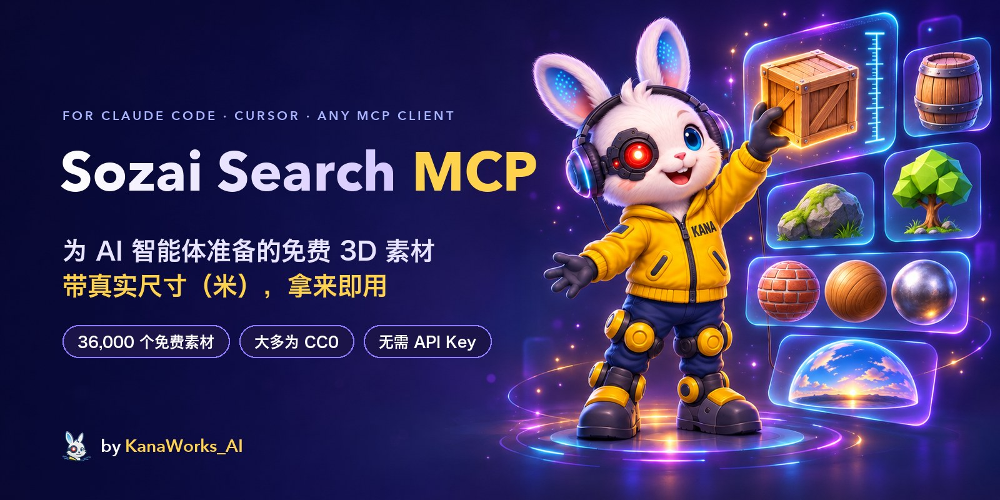

<div align="center">



<p>
  <a href="LICENSE"></a>
  <a href="https://modelcontextprotocol.io"></a>
  
  
  
  <a href="https://github.com/kanaworksai-hue/sozai-search-mcp/actions/workflows/test.yml"></a>
  <a href="https://github.com/kanaworksai-hue/sozai-search-mcp/stargazers"></a>
</p>

<p><a href="https://github.com/kanaworksai-hue"></a>&nbsp;<a href="https://github.com/kanaworksai-hue"><b>KanaWorks_AI 出品</b></a></p>

[English](README.md) | [日本語](README.ja.md) | **简体中文** | [한국어](README.ko.md) | [Português](README.pt-BR.md) | [Español](README.es.md)

[快速开始](#-快速开始) · [工具](#-工具) · [素材来源](#-素材来源与许可证) · [语义搜索](#-语义搜索可选) · [常见问题](#-常见问题) · [⭐ 点个 Star](#-点个-star-支持一下)

</div>

**Sozai Search MCP** 给 Claude Code、Claude Desktop、Cursor 以及任何 [MCP](https://modelcontextprotocol.io) 客户端配上一个收录 **39,000 个免费 3D 素材**的素材库：来自 Poly Haven 和 ambientCG 的写实模型、PBR 材质和 HDRI，来自 Kenney、Quaternius、KayKit 和 Polygonal Mind 的低多边形游戏模型，来自 Open Source Avatars 的带骨骼 VRM 角色，NASA 的航天器、探测车和望远镜，以及 Quixel Megascans 的素材条目。说一句“来个不到 1 米高的木箱”或“一块长满青苔的石头”，智能体就会按关键词或语义搜索，看过预览图，再把文件放进你的项目，尺寸就是以米为单位的真实大小。（*Sozai* 是日语“素材”的读音。）

Sozai Search 只是一个索引，本身不托管任何素材文件：每条结果都指向官方来源，文件由你自己的电脑从那里下载。

## ✨ 亮点

<table>
<tr>
<td align="center" width="25%"><br><b>搜索</b><br><sub>关键词加同义词，也能按语义搜，任何语言都行（搜“长满青苔的石头”也能找到 mossy rock）</sub></td>
<td align="center" width="25%"><br><b>真实尺寸</b><br><sub>所有尺寸以米为单位，可按最大边长、高度和面数筛选</sub></td>
<td align="center" width="25%"><br><b>拿来就用</b><br><sub>每个模型一个 <code>.glb</code>，PBR 贴图文件夹、HDRI，外加 <code>CREDITS.md</code></sub></td>
<td align="center" width="25%"><br><b>免费</b><br><sub>大多是 CC0；<code>redistributable_only</code> 只保留可以随项目分发的素材</sub></td>
</tr>
</table>

- **先看再选：** `view_assets` 最多给智能体看 8 张预览图，让它凭眼睛挑，而不是看标题猜。
- **到手就是正确尺寸：** 素材包模型已校准到米（门 2.1 米，人 1.75 米），交付时已经缩放好，骨骼和动画照常可用。
- **轻量：** 服务器只用 Python 标准库，没有运行时依赖。启动约 25 ms，空闲时约占 23 MB 内存，调用之间不保留状态。
- **处理不可信数据也安全：** 只走 https，而且只连各素材库自己的域名；所有路径都限制在你指定的文件夹内；绝不删除你的文件。

## 🧭 工作原理

```
"来个不到 1 米高的木箱"
   └─ search_assets   关键词 + 语义，按类型、尺寸、高度、面数、许可证筛选
   └─ view_assets     智能体查看候选的预览图
   └─ fetch_asset     从 Poly Haven / ambientCG（或你本地的素材包 zip）下载，
                      打包成真实尺寸的单个 .glb，并把署名追加到 CREDITS.md
```

`sozai build` 只需下载一次发布的数据：一个 zip，里面是所有素材库的记录（每个素材是什么、尺寸、许可证、去哪下载）和搜索向量。不含素材文件，也不含预览图。

## 🚀 快速开始

### 🤖 让 AI 代理帮你安装

把这个仓库的网址交给 Claude Code、Codex 或其他代理，请它安装 Sozai Search MCP。代理会按下面的步骤操作（手动安装也一样）：

1. **uv：** 用 `uv --version` 检查；没有的话先安装：
   - macOS / Linux: `curl -LsSf https://astral.sh/uv/install.sh | sh`
   - Windows: `powershell -ExecutionPolicy ByPass -c "irm https://astral.sh/uv/install.ps1 | iex"`
2. **注册服务器：** 在用户自己的项目文件夹里运行。不需要 clone，uv 会从 GitHub 获取 Sozai Search。

   ```bash
   # Claude Code：只注册到这个项目（写入 .mcp.json）
   claude mcp add sozai -s project -- uvx --from git+https://github.com/kanaworksai-hue/sozai-search-mcp sozai

   # Codex：注册到所有项目（写入 ~/.codex/config.toml）
   codex mcp add sozai -- uvx --from git+https://github.com/kanaworksai-hue/sozai-search-mcp sozai
   ```

   其他客户端（Claude Desktop、Cursor 等）在 JSON 配置里写同样的命令：

   ```json
   {"mcpServers": {"sozai": {"command": "uvx", "args": ["--from", "git+https://github.com/kanaworksai-hue/sozai-search-mcp", "sozai"]}}}
   ```

3. **开一个新会话：** MCP 服务器在会话开始时加载。Claude Code 第一次会请你批准项目的 `.mcp.json`。可以用 `claude mcp list` 或 `codex mcp list` 检查。
4. **试一下：** 搜索 "wooden crate"。第一次搜索会下载公开数据（约 13 MB），几秒内建好索引。给 `fetch_asset` 传项目里某个文件夹的绝对路径。
5. **按意思搜索（可选）：** 要支持描述性的、任何语言的查询，先下载一次查询模型（约 350 MB）：

   ```bash
   uvx --from "sozai-search-mcp[semantic] @ git+https://github.com/kanaworksai-hue/sozai-search-mcp" sozai semantic-setup
   ```

   然后注册时用 `--from "sozai-search-mcp[semantic] @ git+https://github.com/kanaworksai-hue/sozai-search-mcp"` 代替 `--from git+https://github.com/kanaworksai-hue/sozai-search-mcp`。

### 🛠️ 从 clone 安装

需要 [uv](https://docs.astral.sh/uv/)（它会自带 Python 3.10 或更新版本）。

```bash
git clone https://github.com/kanaworksai-hue/sozai-search-mcp
cd sozai-search-mcp
uv sync
uv run sozai build            # 下载发布的数据（一个 zip，不含素材文件）并建立索引
uv run sozai search "wooden crate" --kind model
uv run sozai fetch polyhaven:wooden_crate_01 ./assets --quality web
```

**Claude Code**（只注册到当前项目）：

```bash
claude mcp add sozai -s project -- uv run --directory /path/to/sozai-search-mcp sozai
```

**其他 MCP 客户端**（Claude Desktop、Cursor 等）：

```json
{
  "mcpServers": {
    "sozai": {
      "command": "uv",
      "args": ["run", "--directory", "/path/to/sozai-search-mcp", "sozai"]
    }
  }
}
```

不想 clone 的话，uv 也可以直接从 GitHub 运行：`uvx --from git+https://github.com/kanaworksai-hue/sozai-search-mcp sozai`。如果还没运行过 `sozai build`，第一次搜索时会自动建立索引。请给 `fetch_asset` 传入文件夹的绝对路径：MCP 服务器并不在你的项目目录里运行。

## 🧰 工具

| 工具 | 用途 |
|---|---|
| `search_assets` | 英文关键词加同义词，可按类型、风格、来源、尺寸和高度（米）、面数、可平铺、带骨骼、带动画，以及 `redistributable_only`（可以随开源项目分发的 CC0 文件）筛选。返回精简结果。 |
| `get_asset` | 完整记录：尺寸、贴图、标签、许可证、署名、下载方式。 |
| `view_assets` | 显示最多 8 个候选的预览图。Megascans 的预览图会在需要时从素材的 Fab 页面读取（就像链接预览一样），并缓存下来。 |
| `fetch_asset` | 把文件放进文件夹：模型是单个 `.glb`，材质是一个 PBR 贴图文件夹（Poly Haven 会附带记录真实平铺尺寸的 `material.json`，ambientCG 附带现成的 `.tres` / `.mtlx` / `.blend` 材质），HDRI 是 `.hdr` / `.exr`。署名会追加到 `CREDITS.md`。只会新增或替换该素材自己的文件。 |
| `update_index` | 重建本地索引；当前版本的 Sozai Search 需要更新的发布数据时，会一并下载。 |

尺寸格式为 `[width, height, depth]`，单位是米，height 是竖直向上的轴。材质给出的是一块贴图平铺覆盖区域的 `[width, height]`。

## 📚 素材来源与许可证

| 素材库 | 内容 | 许可证 | 文件 |
|---|---|---|---|
| [Poly Haven](https://polyhaven.com) | 写实模型、材质、HDRI | CC0 | 从 Poly Haven 下载。**Powered by Poly Haven.** |
| [ambientCG](https://ambientcg.com) | 材质、HDRI、贴花、模型 | CC0 | 从 ambientCG 下载 |
| [Kenney](https://kenney.nl) | 低多边形游戏素材包 | CC0 | 来自你下载的素材包 zip（[见下文](#-素材包kenneyquaternius)） |
| [Quaternius](https://quaternius.com) | 低多边形模型，很多带骨骼和动画 | CC0 | 来自你下载的素材包 zip |
| [KayKit](https://kaylousberg.com) | 低多边形游戏素材包：角色、地牢、家具、餐厅、万圣节等 | CC0 | 从 GitHub 下载 |
| [Polygonal Mind](https://github.com/PolygonalMind/initiative-opensource-release) | 来自元宇宙场景的低多边形道具和场景（GLB 版由 [ToxSam](https://github.com/ToxSam/cc0-models-Polygonal-Mind) 转换） | CC0 | 从 GitHub 下载 |
| [Open Source Avatars](https://www.opensourceavatars.com) | 带骨骼的人形 VRM 角色：Polygonal Mind 的 100Avatars（含体素版）等（[注册表](https://github.com/ToxSam/open-source-avatars)） | CC0 | 从 Arweave 下载 |
| [NASA 3D Resources](https://science.nasa.gov/3d-resources/) | 航天器、探测车、望远镜、火箭、小行星和宇航员装备（[仓库](https://github.com/nasa/NASA-3D-Resources)）；各文件单位不统一，所以没有以米为单位的尺寸 | [NASA 媒体使用规定](https://www.nasa.gov/nasa-brand-center/images-and-media/) | 从 GitHub 下载 |
| [Quixel Megascans](https://www.fab.com/sellers/Quixel) | 写实扫描 | Fab Standard License | Sozai Search 无法下载：结果会链接到 Fab |

Megascans 在 Fab 上免费：用 Epic 账号领取后即可下载。可以用在你的项目里，但不能再分发文件。条目里的三个尺寸没有固定的轴顺序，所以以 `dims_m`（从大到小）给出，也不参与高度筛选。

如果连不上数据发布版，`sozai build` 会直接读取各素材库的 API：Poly Haven 和 ambientCG（约 5,300 个素材），但没有素材包的记录、Megascans 和语义搜索。`sozai build --live` 会特意走这条路，用来获取比发布版更新的素材。更新 Sozai Search 之后，第一次搜索会切换到新版本需要的数据发布版。

## 🔎 语义搜索（可选）

```bash
uv sync --extra semantic
uv run sozai semantic-setup   # 下载一次查询模型（约 350 MB）
uv run sozai build            # 如果还没运行过：素材向量包含在发布的数据里
```

注册服务器时要带上这个 extra，才能加载模型：`uv run --directory /path/to/sozai-search-mcp --extra semantic sozai`（JSON 配置里在 `"sozai"` 前面加上 `"--extra", "semantic"`）。

之后搜索也会按语义匹配，任何语言都可以：“中世纪酒馆里能坐的东西”能找到凳子和长椅。每个素材都有一个文字向量，有预览图的还有一个图像向量（[EmbeddingGemma 2](https://huggingface.co/google/embeddinggemma-2)，文字和图像共用同一个向量空间），所以名字很简略的素材包模型也能按外观找到。排序会融合关键词、文字和图像三种排名。

搜索时只运行查询这一步：文本模型以 ONNX int8 在 CPU 上运行，约 45 ms，固定在一个版本并用 SHA-256 校验。它在一个独立的工作进程里运行，第一次搜索时启动，闲置 5 分钟后退出，所以空闲时服务器依然很轻。

## 🧩 素材包（Kenney、Quaternius）

这两个素材库没有 API。它们的模型已经列在发布的数据里，但要等你下载素材包并导入之后，`fetch_asset` 才能交付：

```bash
uv run sozai ingest kenney ~/Downloads/kenney-kits
uv run sozai ingest quaternius ~/Downloads/quaternius-packs
```

Kenney 的 zip 保留下载时的文件名（`kenney_city-kit-commercial_2.1.zip`）。Quaternius 的 zip 命名为 `quaternius_<pack>.zip`，其中 `<pack>` 是素材包页面地址里的名字（`quaternius.com/packs/<pack>.html`）；带 `_fbx`、`_part2` 这类后缀也没问题。这样导入的模型会替换对应的发布记录，不会重复出现。

每个模型都会被测量（尺寸、三角面数、骨骼、动画），并配上素材包的预览图。只有 FBX 的模型在装了 Blender 时会转换成 GLB（保留骨骼和动画片段），没有预览图的模型会用无界面 Blender 渲染一张。有可信参照物的素材包会校准到米；没有的则在 `attributes.size_units` 里保留文件原本的单位，不报告尺寸，这样尺寸筛选就不会把它们误当成米。许可证文件不是 CC0 的素材包，会记录该许可证文件的位置，并排除在 `redistributable_only` 之外。

## ⚙️ 配置

环境变量，全部可选：

| 变量 | 作用 |
|---|---|
| `SOZAI_HOME` | 索引、数据、模型和缓存的存放位置（默认：`~/Library/Application Support/sozai`、`%LOCALAPPDATA%\sozai` 或 `~/.local/share/sozai`）。 |
| `SOZAI_SEMANTIC=0` | 即使装了语义搜索的 extra，也只用关键词搜索。 |
| `SOZAI_FAB_PREVIEWS=0` | 从不读取 Fab 页面来获取 Megascans 预览图。 |
| `SOZAI_BLENDER` / `BLENDER_PATH` | `sozai ingest` 使用的 Blender 可执行文件，在自动找不到时指定。 |

Sozai Search 只通过 https 连接上面这些素材库、GitHub（数据发布版）和 Hugging Face（查询模型）。

## ❓ 常见问题

<details>
<summary><b>素材可以用在商业游戏或视频里吗？</b></summary>

Poly Haven、ambientCG、Kenney、Quaternius、KayKit、Polygonal Mind 和 Open Source Avatars 的素材都是 CC0：任何用途都免费，不需要署名（Sozai Search 仍会写 `CREDITS.md`；另外，通过 API 展示 Poly Haven 素材的地方，Poly Haven 希望注明“Powered by Poly Haven”）。Megascans 适用 Fab Standard License：可以用在你的项目里，但不能再分发文件。按 NASA 的媒体使用规定，NASA 的模型在美国不受版权保护：需要注明来自 NASA，不能暗示 NASA 背书，商用 NASA 的标志或徽章要先取得 NASA 许可。每条结果都会注明许可证。
</details>

<details>
<summary><b>可以把文件放进开源项目一起发布吗？</b></summary>

搜索时加上 `redistributable_only=true`：只保留 CC0 素材，排除 Megascans。
</details>

<details>
<summary><b>为什么 Sozai Search 不能下载 Megascans？</b></summary>

只有 Fab 账号的持有者在（免费）领取之后才能下载。Sozai Search 会把 Fab 链接交给智能体，由它转给你。
</details>

<details>
<summary><b>需要 GPU 或 API Key 吗？</b></summary>

不需要。关键词搜索就是普通的 SQLite；语义搜索在 CPU 上跑一个小模型。不需要任何账号或 Key。
</details>

<details>
<summary><b>为什么素材包模型会提示“download the kit”？</b></summary>

Kenney 和 Quaternius 发布的是 zip，没有 API。从 Sozai Search 给出的链接下载素材包，运行 `sozai ingest`，之后 `fetch_asset` 就会直接从你的 zip 里取出模型。
</details>

## ⭐ 点个 Star 支持一下

如果 Sozai Search 帮你找到了最终用上的素材，请在[仓库页面](https://github.com/kanaworksai-hue/sozai-search-mcp)顶部点一下 **⭐ Star**。免费，只要一秒，作用却不小：

- **让更多人发现它。** Star 越多，项目在 GitHub 上越容易被看到。
- **让更新更有动力。** 每一个 Star 都在告诉我“这个东西有人在用”。

其他支持方式：遇到 bug 或有新想法，欢迎[提 Issue](https://github.com/kanaworksai-hue/sozai-search-mcp/issues)；也欢迎在 X 上分享你做的作品，并带上 [@KanaWorks_AI](https://x.com/KanaWorks_AI)。

## 🛠️ 开发

```bash
uv run pytest                 # 离线测试
uv run python eval/run.py     # 用评测查询检查搜索质量（需要先建好索引）
```

```
src/sozai/
  server.py        MCP 工具和命令行
  protocol.py      基于 stdio 的 MCP（只用标准库）
  search.py        关键词 + 语义排序、筛选
  semantic.py      查询模型的工作进程（ONNX）及其客户端
  index.py         SQLite 索引
  build.py         从发布的数据或各素材库的 API 建立索引
  bundle.py        发布数据的 zip（打包 / 安装）
  fetch.py         下载、打包 .glb、署名
  catalog.py       素材包导入（Kenney、Quaternius）；scale.py 尺寸校准，thumbs.py 预览图
  repos.py         GitHub 上的素材库（KayKit、Polygonal Mind、Open Source Avatars、NASA）
  sources/         Poly Haven、ambientCG、Megascans
```

维护者用 `sozai build --live`、`sozai ingest ...`、`sozai embed`（MLX，`uv sync --extra embed`）和 `sozai pack` 制作数据发布版。

## 📄 许可证与致谢

- **本项目：** [MIT](LICENSE)，© 東京AI映像合同会社（Tokyo AI Visuals LLC）。
- **素材：** 每个素材保留各自的许可证，在每条结果里注明。Sozai Search 不分发任何素材文件。发布的数据自带 `NOTICE.txt`。
- **品牌：** KanaWorks_AI 名称、logo 和 Kana 形象版权归東京AI映像合同会社所有，**不在** MIT 授权范围内。详见 [docs/brand](docs/brand/README.md)。
- **基于：** [Poly Haven](https://polyhaven.com)（Powered by Poly Haven）、[ambientCG](https://ambientcg.com)、[Kenney](https://kenney.nl)、[Quaternius](https://quaternius.com)、[KayKit](https://kaylousberg.com)、[Polygonal Mind](https://github.com/PolygonalMind/initiative-opensource-release)、[Open Source Avatars](https://www.opensourceavatars.com)、[NASA](https://science.nasa.gov/3d-resources/)、[EmbeddingGemma 2](https://huggingface.co/google/embeddinggemma-2) 和 [Model Context Protocol](https://modelcontextprotocol.io)。

本项目是独立项目，与 Epic Games、Quixel、Poly Haven、ambientCG、Kenney、Quaternius、KayKit、Polygonal Mind、Open Source Avatars、NASA、Google、Anthropic 都没有关联，也未获其背书。

<br>

<div align="center">

<a href="https://x.com/KanaWorks_AI"></a>

<p><b><a href="https://x.com/KanaWorks_AI">KanaWorks_AI</a> 用 ♥ 制作</b></p>

<p><sub>如果 Sozai Search 帮你省了时间，点个 ⭐ 就是对更新最好的鼓励，也能让更多人看到它。更多项目：<a href="https://github.com/kanaworksai-hue">github.com/kanaworksai-hue</a></sub></p>

</div>
